# pH electrode simulator and leakage tester for in-circuit measurement of amplifier input current

<!-- HardwareX version. Template: HardwareX article template v2 (June 2021); check the current template linked from the Guide for authors. -->

**Authors:** Ihor Tkachenko*

**Affiliations:** Independent researcher, Kyiv, Ukraine.

**Corresponding author's email address:** tigorlab@gmail.com

## Abstract

When a high-impedance sensor such as a glass pH electrode (100 MΩ to 1 GΩ) is read, the
input current of the amplifier must be known and validated: flowing through the electrode,
1 nA can shift the reading by more than eight pH units. On an assembled board this current
includes leakage, yet it is rarely checked, because electrometers are expensive and must be
connected to the input node. We present an open-source tester that
measures it in place. A measured voltage reaches the amplifier through a 50 MΩ resistor
with a shorting button. With the resistor shorted, the tester records the amplifier's
transfer line; with it in circuit, it recovers the input voltage from the amplifier's own
output and calculates the current. Nothing touches the input node, and toggling the
resistor cancels slow drift. Currents of 0.17 to 1.7 nA drawn through a known resistor were
recovered within 0.3 %, with a statistical resolution of 0.06–0.1 pA. The tester
showed that the 12 nA leakage of a failed amplifier behaves as a current source, separated
nonlinearity, input current and interference in a commercial PH-4502C module, and measured
1–3.5 pA on an isolated amplifier.

## Keywords

pH measurement; input bias current; leakage test; electrode simulator; electrometer; open hardware

## Specifications table

| | |
|---|---|
| Hardware name | pH electrode simulator and leakage tester for in-circuit measurement of amplifier input current |
| Subject area | Chemistry and biochemistry |
| Hardware type | Measuring physical properties and in-lab sensors |
| Closest commercial analog | We are not aware of a commercial instrument that measures the input current of a pH amplifier in circuit. Closest: pH/mV electrode simulators (e.g. Hanna HI8427, HI931001) and electrometers or picoammeters. |
| Open source license | Hardware: CERN-OHL-S-2.0; firmware and scripts: GPL-3.0-or-later; documentation and data: CC BY-SA 4.0 |
| Cost of hardware | About EUR 15 (see Bill of materials) |
| Source file repository | https://github.com/igorlab/ph-leakage-tester (archive: TODO Zenodo DOI) |

## 1. Hardware in context

Glass pH, ORP and ion-selective electrodes are read through amplifiers whose input must
draw almost no current. A combined glass electrode follows the Nernst equation with a slope
of 59.16 mV per pH unit at 25 °C [1, 2, 3], but its membrane has an internal resistance of
100 MΩ to 1 GΩ, higher at low temperature [2]. A current I drawn by the amplifier input
flows through this resistance and adds I·R_el to the signal. At 1 pA and 500 MΩ the error
is 0.5 mV, below 0.01 pH; at 10 nA it is 5 V, and the electrode is effectively disconnected
(Figure 1). Wherever the pH reading is the measurement itself, as in the titration of
carbonate alkalinity that follows the sample down to an end point near pH 4 [4], this
current becomes an error of the result.

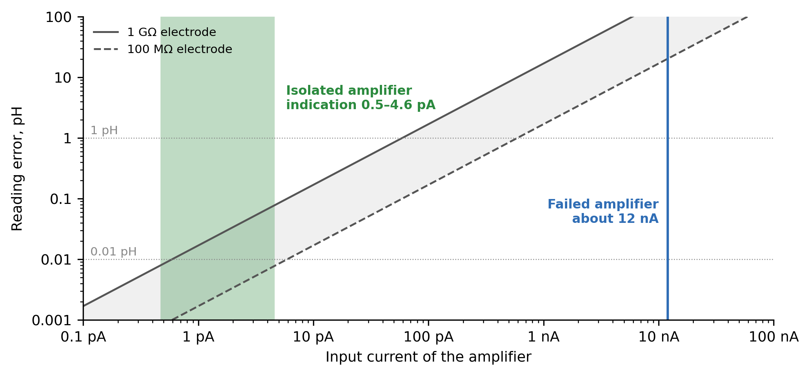

*Figure 1. Reading error in pH units against the input current of the amplifier, for an
electrode of 100 MΩ (dashed) and 1 GΩ (solid). Blue band: the failed amplifier,
8–13 nA. Green band: the isolated amplifier, 1–3.5 pA over ±100 mV (toggle
runs).*

The input current of an assembled amplifier is not only a property of its operational
amplifier: flux residue, contamination, protection components and layout can each add
leakage. A datasheet value of a few femtoamperes therefore says little about a finished
board.

Measuring this current is difficult with common tools. Electrometers and picoammeters [5]
are expensive and need access to the high-impedance node. Commercial pH simulators set a
voltage; some, such as the Hanna HI8427, also check cables and connectors for leakage with
a sensitivity of 10⁹ Ω [6], but they do not measure the current drawn by the meter.
Classic simulators such as the I-02 (1988) (Figure 2a) use a mercury standard cell and
resistor decades and can insert 500 or 1000 MΩ in series to imitate the glass; a leaky
input is recognised by comparing readings with and without this resistance, manually and
without a number for the current. To the best of our knowledge, no open, low-cost
instrument measures the input current of a pH amplifier in place.

[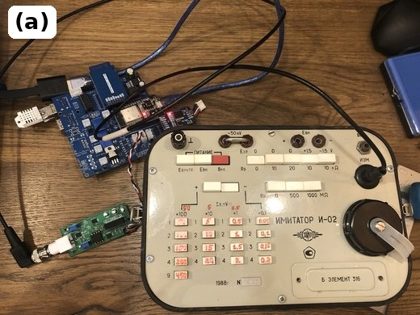](article/img/i-02.jpg)
[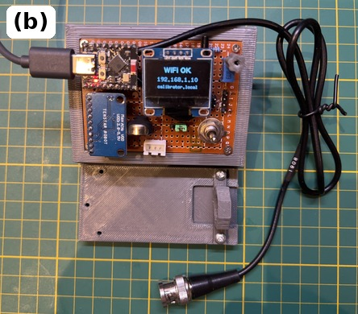](figures/photo_calibrator.jpg)

*Figure 2. (a) The I-02 electrode simulator (1988): a mercury standard cell, decades of
resistors and switchable series resistances of 500 and 1000 MΩ. (b) The tester described
here, on a 1 cm grid, with its BNC cable; the display shows the network address of its web
page.*

This work was motivated by an early amplifier built for an alkalinity titrator: its input
drew 8–13 nA, and a working electrode did not change the board's output. We present a tester (Figure 2b) that automates and quantifies the series-resistance test. It produces an
arbitrary voltage E from an LR44 cell and measures it with an ADS1115 before a 50 MΩ
series resistor, while the same ADC reads the amplifier output S. With the resistor
shorted, two points give the amplifier's transfer line; with the resistor in circuit, the
input recovered from S differs from E by the drop caused by the input current. The
amplifier under test thus serves as its own electrometer, and the current is logged
continuously. The tester was verified with currents of 0.17 to 1.7 nA drawn through a known
resistor and applied to three test cases: the failed amplifier, the isolated amplifier and a
commercial PH-4502C module. Its parts cost about EUR 15 (Section 4).

Published open pH hardware reads the output of a commercial meter [7], uses a commercial
ISFET sensor and analyser [8], or an Atlas Scientific EZO pH circuit on an isolated
carrier board [9]; none reports the input current of the interface. Commercial simulators such as
the Hanna HI931001 and HI8427 set a voltage, and the HI8427 also checks for leakage at
10⁹ Ω [6]; picoammeters [5] measure the
current directly but cost far more and need the node opened. Isolated amplifiers are sold,
for example the Atlas Scientific EZO-pH on an isolated carrier board (about USD 46 + 42)
[10], but as closed designs. The tester measures the current in place, through the
board's own output, continuously and with a log, and separates it from nonlinearity and
pickup.

## 2. Hardware description

The tester measures the input current of an amplifier through the amplifier's own
output (Figure 3). Its hardware and firmware are described below.

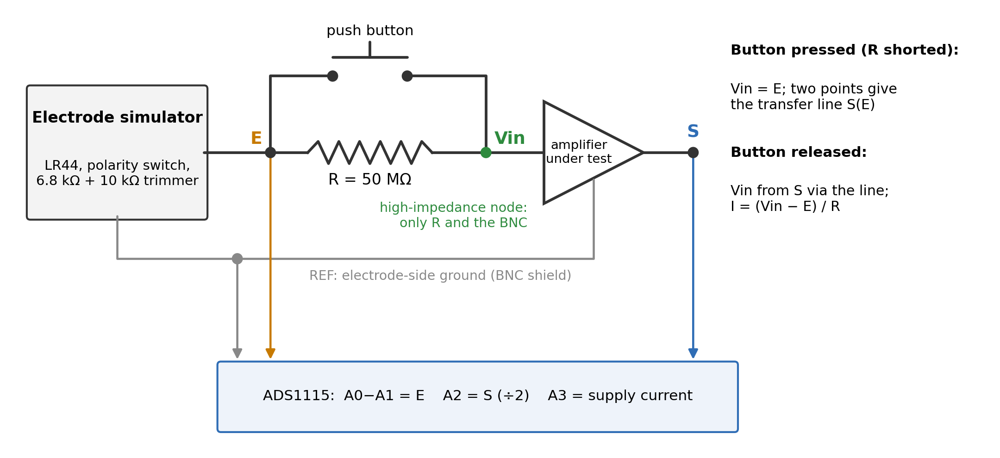

*Figure 3. Measurement principle. The simulator voltage E is measured before the series
resistor R and reaches the amplifier input through it. With the button pressed (R shorted)
the input equals E, and two points give the amplifier's transfer line S(E). With the button
released, the input Vin is recovered from the output S through that line, and the input
current is I = (Vin − E)/R. Only R and the BNC connect to the high-impedance node.*

**Tester.** The tester (Figures 4 and 5) combines an electrode simulator with a
measuring unit. The simulator consists of an LR44 cell, a DPDT ON-OFF-ON switch wired for
polarity reversal, a 6.8 kΩ resistor and a 10 kΩ trimmer, whose wiper provides the
simulator voltage E. E reaches the BNC centre through a series resistor R of 50 MΩ (five
10 MΩ 5 % resistors, size 1206, soldered end to end and standing clear of the board), which a push button shorts during calibration. The
simulator floats: its low side takes its potential from the amplifier under test, as a
real electrode does, so the simulator voltage channel is valid only with an amplifier
connected.

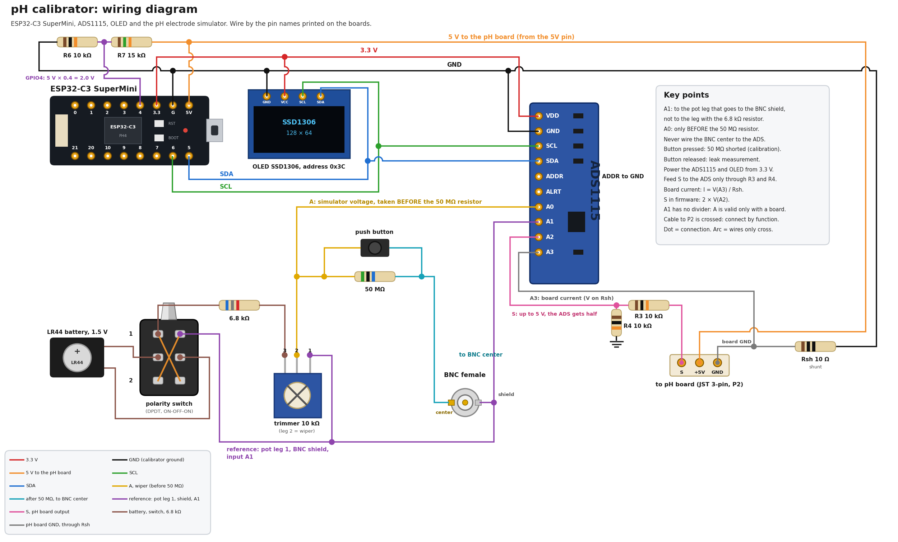

*Figure 4. Schematic of the tester, including USB-supply measurement on GPIO4
(KiCad source in `hardware/`).*

[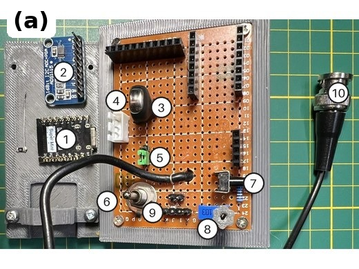](figures/photo_calibrator_inside.jpg)
[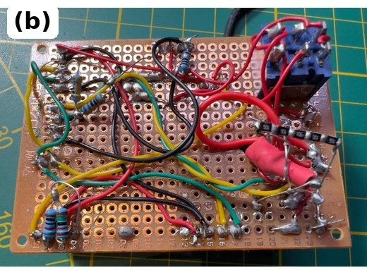](figures/soldering.jpg)\
[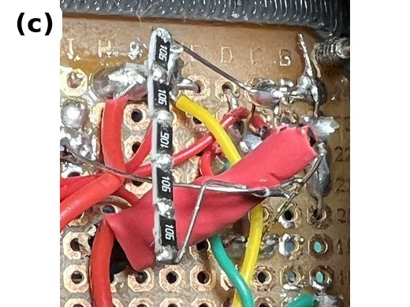](figures/photo_r50m.jpg)
[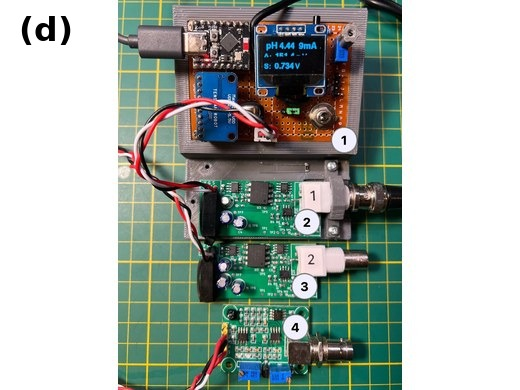](figures/photo_boards.jpg)
[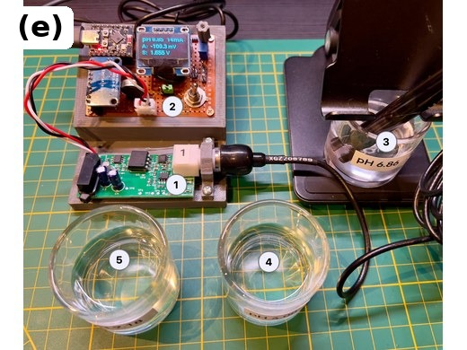](figures/photo_setup_f.jpg)

*Figure 5. The tester. (a) Inside: (1) ESP32-C3 Super Mini, (2) ADS1115, (3) LR44
cell, (4) J2 to the amplifier, (5) JP1, supply jumper for the amplifier, set to 5 V, (6) polarity switch, (7) button
shorting R, (8) trimmer setting E, (9) test pins, (10) BNC plug. (b) The series resistor R
and point-to-point wiring on the underside of the perfboard. (c) Close-up of R, standing
clear of the perfboard. (d) (1) The tester, (2, 3) two isolated amplifiers and
(4) a PH-4502C module. (e) Buffer test setup: (1) isolated
amplifier, (2) tester, (3) electrode and (4, 5) the other buffer solutions.*

An ADS1115 [11] measures E differentially before the series resistor (inputs A0–A1,
±2.048 V range), the amplifier output S through a 10 kΩ / 10 kΩ divider (A2, ±4.096 V
range) and the supply current of the amplifier on a 10 Ω shunt in its ground return (A3,
±0.512 V range). A 15 kΩ / 10 kΩ
divider scales the USB 5 V rail by 0.4 for measurement on the ESP32-C3's GPIO4 ADC input;
its calibration factor is stored in non-volatile memory. The node after the
series resistor is never connected to the ADC, because the ADC input would itself become
the leakage being measured. The amplifier under test is supplied from the tester at
5 V; a jumper (JP1) on the prototype also offers 3.3 V, which was not used and is not shown
in Figure 4. An ESP32-C3 SuperMini runs the firmware, and an SSD1306
OLED displays the readings. Each channel averages 25 samples, and one measurement cycle
takes about 0.4 s. E and S are then smoothed by an adaptive exponential filter (weight 0.35
per cycle, bypassed for steps larger than 0.4 mV in E or 3 mV in S) before the current is
computed.

**Measurement principle.** With the button pressed, the amplifier input equals E. Two
points (E1, S1) and (E2, S2), usually at about +100 and −100 mV, define the amplifier's
transfer line: gain = (S2 − S1)/(E2 − E1) and zero = S1 − gain·E1. Each point is taken after a 30 s pause. With the button released, the amplifier input is recovered from its own output as
Vin = (S − zero)/gain, and the input current follows from the voltage drop across the
series resistor, I = (Vin − E)/R. With R = 50 MΩ and a gain of about 6 V/V, one ADC count
of S (125 µV on the ±4.096 V range, 250 µV at S after the divider) corresponds to about
40 µV at the amplifier input, or 0.8 pA. Averaging over samples and readings brings the
statistical resolution below one count (Section 7.3). Because the zero of the transfer
line drifts slowly, small currents are measured by toggling: at a fixed E the button is
pressed and released in phases of 30–60 s, and the current is the difference of Vin − E
between each open phase and the mean of the shorted phases before and after it, divided
by R. After the button is switched the output settles within a few seconds; the first
10–30 s of each phase are discarded. The drift appears in both states and cancels; the logger guides the operator through
the phases (`tools/calibrator_log.py -g toggle`).

**Software.** The ESP32 serves a web page (English and Ukrainian) with the readings, the
calibration line, time charts of the input current and an equilibrium timer for real
electrodes. For measurements, a host script (`tools/calibrator_log.py`) polls the same data
once per second and writes a CSV file; \1 The firmware and its web page keep the working name “pH Calibrator” (host name `calibrator.local`). The numbers reported below can be recomputed from the
CSV files with `analysis/paper_numbers.py`.

The tester can help other researchers to:

- measure the input current of a finished pH, ORP or ion-selective electrode amplifier in
  place, without connecting an instrument to its high-impedance node;
- separate input current, transfer-function nonlinearity and interference pickup, which a
  single reading combines;
- check an amplifier before installation, after repair or cleaning, or when its readings
  drift;
- log the input current continuously, for leakage that changes with time or humidity;
- demonstrate in teaching how electrode resistance and input current corrupt pH readings.

The method applies to any electrometer amplifier with a linear transfer function, such as
amplifiers for ORP and ion-selective electrodes, hydroponics sensors, and high-impedance
photodiode or ionisation-chamber amplifiers. The series resistance is entered on the web
page, and the gain and zero are measured rather than assumed, so other gains need no
firmware changes.

## 3. Design files summary

The hardware is released under a licence that follows the Open Source Hardware definition [17].

| Design filename | File type | Open source license | Location of the file |
|---|---|---|---|
| `hardware/calibrator.kicad_sch` | KiCad schematic | CERN-OHL-S-2.0 | TODO: Zenodo DOI |
| `figures/fig_calibrator_schematic` | Wiring diagram (figure) | CC BY-SA 4.0 | TODO: Zenodo DOI |
| `hardware/enclosure/pH-tester.STL` | Enclosure, 3D model for printing (82 × 107 × 41 mm) | CERN-OHL-S-2.0 | TODO: Zenodo DOI |
| `hardware/enclosure/board_holder.STL` | Board holder, 3D model for printing (6 × 38 × 18 mm) | CERN-OHL-S-2.0 | TODO: Zenodo DOI |
| `firmware/` (`src/main.cpp`, `platformio.ini`) | Firmware source (C++, PlatformIO) | GPL-3.0-or-later | TODO: Zenodo DOI |
| `tools/calibrator_log.py` | Python data logger | GPL-3.0-or-later | TODO: Zenodo DOI |
| `tools/new_runs.py`, `analysis/paper_numbers.py` | Python analysis scripts | GPL-3.0-or-later | TODO: Zenodo DOI |
| `data/` | Raw measurement logs (CSV) with README | CC BY-SA 4.0 | TODO: Zenodo DOI |

`hardware/calibrator.kicad_sch` is the editable schematic of the tester.
`figures/fig_calibrator_schematic` shows the same circuit as a wiring diagram of the
modules (Figure 4) for point-to-point assembly. The enclosure holds the perfboard, the
modules and the BNC plug. The firmware runs on the ESP32-C3, reads the ADS1115, computes the
transfer line and the current, drives the OLED and serves the web page. `calibrator_log.py`
records the readings once per second to CSV and guides toggle runs. `new_runs.py` analyses
toggle and noise runs; `paper_numbers.py` recomputes every number in this article from the
CSV files in `data/`, whose README documents each protocol and the correction for the
series resistance.

## 4. Bill of materials summary

| Designator (KiCad schematic) | Component | Number | Cost per unit | Total cost | Source of materials | Material type |
|---|---|---|---|---|---|---|
| U1 | ESP32-C3 SuperMini | 1 | 1.47 | 1.47 | AliExpress, 10 pcs for EUR 14.69 (Jan 2026) | Semiconductor |
| U2 | ADS1115 16-bit ADC module | 1 | 3.23 | 3.23 | Amazon, 3 pcs for EUR 9.69 | Semiconductor |
| U3 | SSD1306 128×64 I²C OLED display | 1 | 3.66 | 3.66 | Amazon, 3 pcs for EUR 10.99 | Semiconductor |
| BT1 | LR44 cell and holder | 1 | 1.00 | 1.00 | Cell bought for EUR 1; holder salvaged from an old toy | Non-specific |
| SW1 | DPDT ON-OFF-ON toggle switch (polarity) | 1 | 2.00 | 2.00 | Purchased, EUR 2 | Non-specific |
| SW2 | Push button shorting R2 | 1 | 0.05 | 0.05 | AliExpress, 6×6 mm tactile switches, 20 pcs for EUR 0.92 | Non-specific |
| RV1 | 10 kΩ trimmer potentiometer | 1 | 0.09 | 0.09 | AliExpress, 3296W, 20 pcs for USD 1.84 (2022) | Non-specific |
| R1 | Resistor 6.8 kΩ | 1 | 0.01 | 0.01 | AliExpress, 1/4 W metal-film assortment, 100 pcs for EUR 0.58 | Non-specific |
| R2 | Resistor 10 MΩ, 5 %, 1206 (five in series, 50 MΩ) | 5 | 0.02 | 0.09 | AliExpress, 1206 SMD assortment, 100 pcs for EUR 1.70 | Non-specific |
| R3, R4 | Resistor 10 kΩ (divider for S) | 2 | 0.01 | 0.01 | as R1 | Non-specific |
| R5 | Resistor 10 Ω (supply-current shunt; Rsh in Figure 4) | 1 | 0.01 | 0.01 | as R1 | Non-specific |
| R6, R7 | Resistors 10 kΩ and 15 kΩ (USB voltage divider) | 2 | 0.01 | 0.01 | as R1 | Non-specific |
| J1 | BNC female connector | 1 | 0 | 0 | Salvaged from an old electrode | Metal |
| J2 | JST 3-pin connector and cable to the amplifier | 1 | 0.84 | 0.84 | AliExpress, XH2.54 kit of 230 pcs for EUR 0.84 (whole kit) | Non-specific |
| JP1 | 3-pin header and jumper (amplifier supply, set to 5 V) | 1 | 0.09 | 0.09 | AliExpress, pin-header strips, 100 pcs for EUR 8.79 | Non-specific |
| TP1–TP3 | Test pins (REF, E, VIN) | 3 | 0.09 | 0.26 | as JP1 | Metal |
| – | Perfboard | 1 | 1.50 | 1.50 | Amazon, 5×7 cm | Composite |
| – | 3D-printed enclosure (PLA, 35 g) | 1 | 0.63 | 0.63 | PLA filament, EUR 18 per kg | Polymer |

The 10 MΩ resistors are ordinary thick-film parts; their tolerance does not matter, because
the sum of the five is measured and entered on the web page (Section 5).

## 5. Build instructions

The tester is built from ready-made modules wired point-to-point on perfboard
(Figures 4 and 5). The build takes about one day, including printing the enclosure, soldering, flashing and checking.

1. **Power and digital part.** Mount the ESP32-C3, the ADS1115 and the OLED. Supply the
   ADS1115 and the OLED from the 3.3 V pin of the ESP32-C3, never from 5 V: 5 V on the I²C
   bus would damage the ESP32-C3. Connect SDA and SCL as in Figure 4 and tie ADDR of the
   ADS1115 to GND (address 0x48). Connect the USB voltage divider (R6, R7) to GPIO4.
2. **Measurement channels.** Connect A0 to the trimmer wiper (the simulator voltage E,
   before the series resistor) and A1 to the reference leg of the trimmer, which is also
   the BNC shield. Feed the amplifier output S to A2 only through the R3/R4 divider. Insert
   the 10 Ω shunt R5 (Rsh in Figure 4) in the ground return of the amplifier and connect its upper end to A3.
   Never connect the node after the series resistor to the ADC: the ADC input would itself
   become the leakage being measured.
3. **Electrode simulator.** Wire the LR44 cell to the DPDT switch for polarity reversal
   (the centre position switches the cell off), then through the 6.8 kΩ resistor to the
   10 kΩ trimmer, whose wiper gives E.
4. **Series resistor R.** Solder five 10 MΩ 1206 resistors end to end so that the chain
   stands clear of the perfboard (Figure 5c), and connect the push button across the whole
   chain. Keep the node between R and the BNC centre off the perfboard. Before connecting
   the chain, measure each resistor separately on the 40 MΩ range of a multimeter without
   touching the probe tips (the body resistance in parallel lowers the reading) and use the
   sum as R.
5. **Cable to the amplifier.** The cable between the tester (GND, supply, S) and the
   amplifier connector P2 (VCC, com, S) is crossed; connect it by function and check it
   before the first power-up.
6. **Cleaning.** Wash the flux off around the series resistor, the button and the BNC,
   because these nodes carry picoampere currents.
7. **Firmware.** Build and upload the firmware with PlatformIO (pioarduino platform
   55.03.312-1, Arduino core 3.3.12, ESP-IDF 5.5.5; libraries pinned: Adafruit ADS1X15
   2.6.2, Adafruit BusIO 1.17.4, U8g2 2.36.18, AsyncTCP 3.5.0, ESPAsyncWebServer 3.12.1).
   Wi-Fi credentials go in `src/wifi_secret.h`, which is not part of the repository.

*Design decisions.* The series resistance of 50 MΩ is a compromise: a larger value increases
the sensitivity, but then the wiring, the push button and the operator's hands leak as
much as a faulty board, which would require guarding, PTFE insulation and a shielded
enclosure [5]. The simulator floats, as a real electrode does, so the simulator voltage
channel is valid only with an amplifier connected.

*Safety.* No voltage exceeds 5.5 V. The galvanic isolation is functional (it breaks ground loops
through the water), not a safety barrier. The ADS1115 and the OLED must be supplied from 3.3 V, because 5 V on the I²C bus
would damage the ESP32-C3.

## 6. Operation instructions

1. Connect the amplifier under test to the BNC plug and its connector P2 to the tester
   cable. The tester supplies the amplifier with 5 V.
2. Power the tester from USB. The display shows its network address (Figure 2b), and the
   web page opens at `calibrator.local` (Figure 6). Enter the measured series resistance
   in “Resistor R, MΩ” and press “Save R”.
3. **Transfer line.** Press and hold (or tape) the button. Set E to about +100 mV with the
   polarity switch and the trimmer (reading “A” at the top of the page), wait 30 s and press
   “Capture point 1”; repeat at about −100 mV with “Capture point 2”. The page shows the
   gain and zero of the line.
4. **Input current.** Release the button and keep hands away from the BNC, the cable and the
   resistor. The page shows the leakage current, a comparison with a user-set limit
   (“Leak norm, nA”) and a time chart.
5. **Small currents.** Below about 10 pA, use toggle runs, which cancel drift of the zero:
   `python3 tools/calibrator_log.py -o run.csv -g toggle -n 8 -p 60` guides the operator
   through shorted and open phases with a countdown and a beep, and
   `python3 tools/new_runs.py toggle run.csv` gives the current of each cycle. Tape the
   button rather than holding it, and wait about 10 min after changing E.
6. **Logging.** `python3 tools/calibrator_log.py -o run.csv` records all readings once per
   second; typed notes are stored as marks. The page also keeps about 14 h of history in the
   browser, which “Download CSV” saves.

The second block of the page converts the amplifier output to pH with a three-buffer
electrode calibration; it is not needed to measure the current.

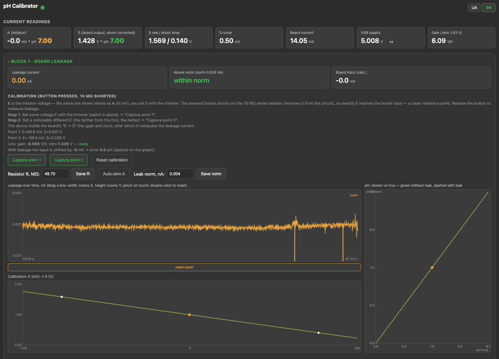

*Figure 6. Web page of the tester, block 1 (board leakage): current readings, the
two-point transfer line, the series resistance and the leakage limit, the leakage current
over time and the transfer line E → S.*

<!-- TODO: retake the screenshot after flashing firmware_4 (the heading still says “10 MΩ shorted”). -->

The tester works below 5.5 V and needs no special precautions; the ADS1115 and the OLED
must stay on 3.3 V (Section 5).

## 7. Validation and characterization

### 7.1 Simulator voltage

The amplifier is calibrated in the titrator with pH 4.00 and 6.86 buffers. The tester
needs no calibration of its own beyond the two-point line taken for each amplifier. This
line is taken anew before every series to capture the actual gain and zero at the time of
measurement.

The simulator voltage was checked against a Mastech MS8229 multimeter at the BNC with the
button pressed (protocol C,
`data/C_channel_A.csv`). Over ±200 mV the slope was 1.0003 and the offset
−0.06 mV; the largest difference, 0.2 mV (0.003 pH), is within the multimeter's last digit.

The isolated amplifier was calibrated at approximately ±100 mV after a 30 s pause at each
point. A final post-experiment check reproduced both applied voltages without a detectable
systematic shift (`data/F_final_check_visible.csv`).

### 7.2 Amplifier under test

**Amplifier under test.** Most tests used a galvanically isolated pH amplifier built for
the titrator (directory `ph_board/` of the repository). It is a revision of the interface shared by Franck
("Bubule") on cap-recifal.com in 2011 [12]: a CMOS input stage (LMC6042 [13], gain 6.13),
an HCNR201 analog optocoupler in the servo-photodiode configuration [14] and an isolated
DC-DC converter. With the original values, our builds were damaged when the
electrode was disconnected. We therefore replaced the trimmers with fixed
resistors, raised the LED series resistor from 255 to 470 Ω, increased the servo-loop and
output capacitors from 10 pF to 56 nF and 1 µF, and laid the board out anew. The tested
board also takes its reference from a REF3040 [15] and has its input pin wired in air to
the BNC centre (Figure 7). Its output S runs from 0.5 V at pH 4 to 2.45 V at pH 9.38. An
earlier prototype took its reference from the +5 V rail; it appears only in the
supply-sensitivity comparison. Component values and the rework are documented
in the repository. The amplifier serves here only as a device under test.

[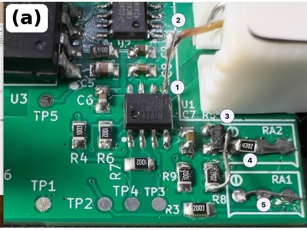](figures/photo_board_input.jpg)
[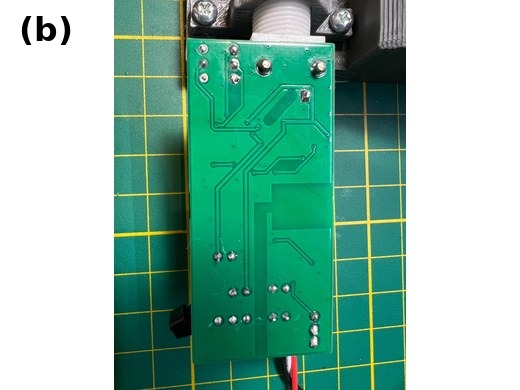](photos/board_a_bottom.png)

*Figure 7. The amplifier board reworked for the REF3040 reference. (a) Component side:
(1) input pin 5 of the LMC6042, lifted from the board; (2) flying wire from this pin to
the BNC centre; (3) REF3040 voltage reference; (4) 47 kΩ resistor on RA2; (5) wire link in
place of RA1. (b) Underside of the same board, showing the isolation gap between the
electrode and station sides.*

### 7.3 Performance

**Known currents.** The accuracy of the current measurement was tested with a resistor
Rt = 9.73 MΩ connected across the amplifier input (protocol A, `data/A_10M_run3.csv`).
Rt draws a known current I = −E/(R + Rt) through the series resistor. R = 49.61 MΩ is the
sum of its five resistors, each measured on the 40 MΩ range of the same multimeter; the
specified uncertainty, ±(2 % + 5 digits) per reading, gives about ±2.5 % for R and limits
the absolute accuracy of the current to the same level. Independently, the ratio Vin/E
measured by the tester with Rt connected gives R = 49.70 MΩ for the same Rt, within
0.2 % of the sum. The logs were recorded with an earlier, incorrect value of 47.94 MΩ in
the firmware; all currents measured through R in this paper are rescaled by
47.94/49.61 = 0.966. At each of
three voltages the reading was recorded for 1 min without Rt, 2 min with it and 1 min
without it again; the median without Rt was subtracted from the median with Rt. The
measured differences agreed with the calculated currents within 0.3 % (Table 1,
Figure 8). In the 30 mV series the phase after Rt was removed was recorded at E = 10.2 mV;
using only the baseline at 30 mV changes that deviation from +0.2 % to +0.4 %.

*Table 1. Known currents through Rt = 9.73 MΩ with R = 49.61 MΩ.*

| E | expected | measured | difference |
|---|---|---|---|
| 100.0 mV | −1.685 nA | −1.686 nA | +0.07 % |
| 30.0 mV | −0.506 nA | −0.506 nA | +0.16 % |
| 10.0 mV | −0.169 nA | −0.168 nA | −0.24 % |

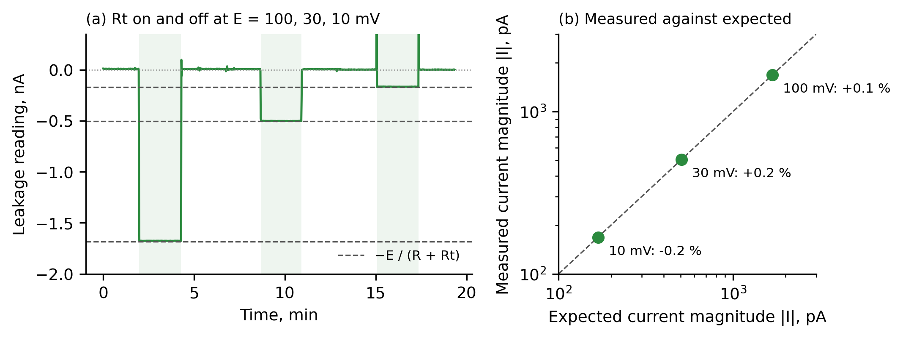

*Figure 8. Known currents. (a) Current reading while a 9.73 MΩ resistor is connected
(shaded) and removed at E = 100, 30 and 10 mV; dashed: −E/(R + Rt). (b) Measured against
expected current.*

**Noise floor.** With the isolated amplifier connected, E ≈ +100 mV and no external test
resistor, the current was logged for one hour with the series resistor shorted and for one
hour with it in circuit (`data/B3_noise_shorted_2026-10-28.csv`,
`data/B2_noise_open_2026-10-28.csv`). The Allan deviation of the indicated current was
0.19 pA (shorted) and 0.43 pA (in circuit) at 1 s, and 0.06 and 0.10 pA at 1 min; above
about 5 min both were 0.08–0.10 pA. The high-impedance node therefore doubles the
short-term noise, while at long averaging times both are limited by drift of the measuring
chain. With the resistor shorted the true current is zero, yet the indicated current rose
from +0.05 to +0.49 pA over the hour: the zero of the transfer line drifts by up to about
0.5 pA per hour, which the toggle method removes. These figures describe statistical
resolution, not calibrated accuracy below the lowest verified source, 0.17 nA.

**Linearity of the isolated amplifier.** With the tester correcting the voltage drop across its 10 Ω
supply-current shunt, eight stable points from −201.0 to +219.9 mV gave a gain of
−6.0867 V/V and a zero of 1.42810 V; the largest output residual was 0.402 mV, or
66 µV (0.001 pH) referred to the input (`data/A_REF3040_linearity_2026-10-26_run2.csv`, Figure 9). At +250.1 mV the
output reached the lower rail and was excluded from the fit.

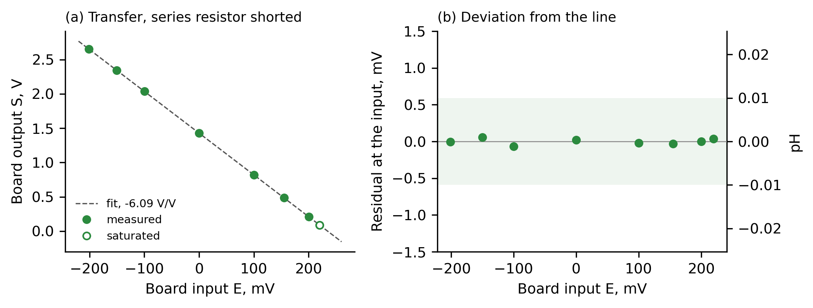

*Figure 9. Linearity of the isolated amplifier with the series resistor shorted.
(a) Output S against input E with the fitted line; open circle: beyond the linear range.
(b) Deviation from the line, referred to the input, in mV and in pH; shaded: ±0.01 pH.*

**Input current of the isolated amplifier.** Toggle runs gave −3.18 ± 0.12 pA at E = −99 mV
(eight cycles of 60 s, mean ± SEM; `data/T_toggle_REF3040_2026-10-28.csv`, Figure 10) and
−1.14 ± 0.07 pA at E = +100 mV (eight cycles of 30 s;
`data/T_toggle_+100_REF3040_2026-10-28.csv`); in the same phases the transfer line gave
−3.27 and −1.12 pA. When the button was held by hand, the reading of E differed by
8–31 µV between the two states; with the button taped, at the unattended transition
between the two one-hour runs, the difference was 4 µV and the current was −1.3 pA. The
current at +100 mV is therefore given as −1.3 pA, and the hand-held toggle runs (−1.1 to
−1.8 pA) bound its uncertainty. The input current of the board, including any leakage of
the tester's own input node, thus depends on E and lies between −1 and −3.5 pA over
±100 mV.

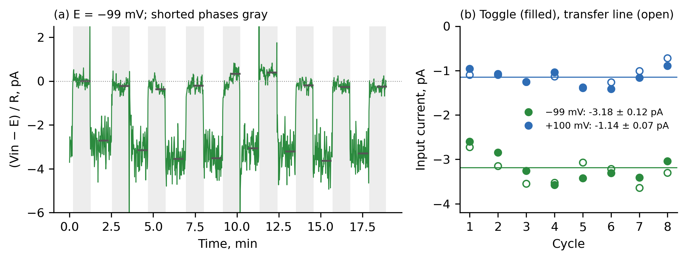

*Figure 10. Toggle runs on the isolated amplifier. (a) (Vin − E)/R during the run at
E = −99 mV; grey: resistor shorted by the button; bars: phase means used; spikes while the
button is handled are clipped. (b) Current of each cycle from the toggle method (filled)
and from the transfer line (open) at E = −99 mV (green) and +100 mV (blue); lines: means of
the toggle method.*

The REF3040 reference removes the supply sensitivity that motivated the change. In a
supply sweep from 4.70 to 5.53 V, the isolated amplifier changed by 0.4 mV per volt, or approximately
0.001 pH/V, within the resolution of the test. For historical comparison only, the
earlier divider prototype changed by 323 ± 6 mV per volt (0.87 pH/V) over its measured
USB range (`data/E_supply2.csv`). No other performance result from the divider revision
is used in this paper.

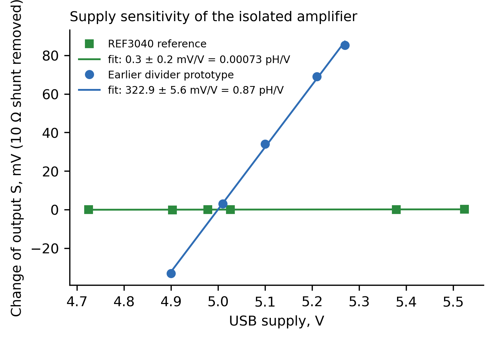{width=60%}

*Figure 11. Supply sensitivity of the isolated amplifier with the REF3040 reference and, for historical
comparison only, the earlier divider prototype. Output S is corrected point by point for
the voltage drop across the tester's 10 Ω current shunt.*

**Failed amplifier.** That board showed an input shift of 90–205 mV with a 10–20 MΩ
source, corresponding to 8–13 nA and an error of 1.5–3.5 pH. Replacing the LMC6042 with another LMC6042 and with a TL062 (JFET input) did not change
the current, so the operational amplifier was not the cause. The tester then measured
the current at seven voltages from −300 to +300 mV with R = 20 MΩ (protocol H; values
transcribed from the logger display, raw log not preserved): 12.01 nA on average,
standard deviation 0.06 nA, slope −0.08 ± 0.11 nA/V. A saturated or strongly nonlinear
output would have produced a slope near −1/R = −50 nA/V. Any resistive leakage path must
exceed 2.5 GΩ (3σ), and driving 12 nA through it would need more than 30 V, far beyond
the ±5 V on the board. The leakage
therefore behaves as a current source rather than as a resistance. Its physical origin was
not identified, and the board was replaced by the redesign.

**Commercial module.** As an example of a widely used low-cost board, a diymore PH-4502C
module was tested (protocol G, `data/G_ph4502c.csv`). Its input stage is a TLC4502C [16]
(CMOS input), followed by two LM358; the module is not isolated. After a two-point
calibration at ±100 mV (+2.863 V/V, zero 2.470 V), each voltage from −431 to +425 mV was
applied in an upward sweep with the series resistor in circuit and then in a downward
sweep with it shorted. With the resistor
shorted no input current can flow, yet the reading departed from the line by 5 mV at
±250 mV and 11 mV at ±430 mV (0.09 and 0.19 pH); the isolated amplifier stays within
0.13 mV on the same basis (Figure 12a). The errors at ±250 and ±430 mV agreed
between the two sweeps within 0.2 mV, so they are not caused by drift; at E = 0 the two
sweeps disagree by 3.4 mV, for a reason that was not identified. The difference between the two states, the actual
input current, was within about ±15 pA of zero (Figure 12b). With the resistor in circuit,
the module's reading scattered by 30–40 pA; with the resistor shorted the scatter
disappeared, which indicates interference
pickup at the high-impedance node; whether it enters at the module input or through the
tester's own node was not separated. The tester thus separates nonlinearity, input current and
interference, which a single reading combines.

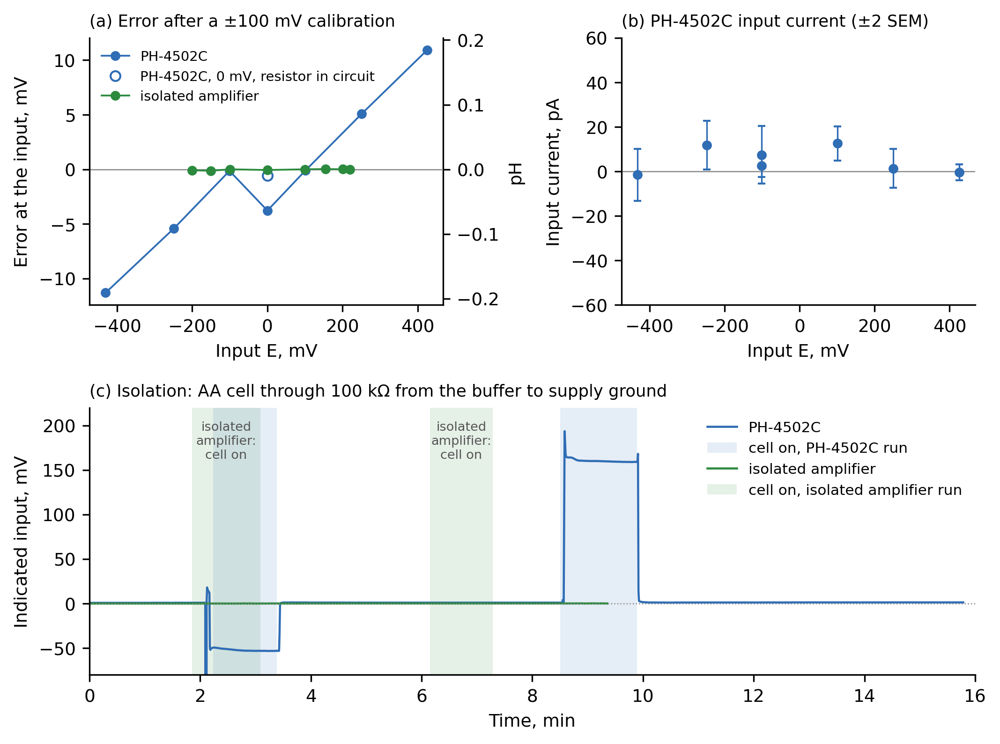

*Figure 12. A PH-4502C module and the isolated amplifier. (a) Error referred to the
input after a two-point calibration at ±100 mV, resistor shorted. (b) Input current of the
module: reading with the resistor in circuit minus the reading shorted; bars ±2 standard
errors. At E = 0 the two sweeps disagree by 3.4 mV (−0.4 and −3.8 mV); both points are
shown, and the cause was not identified.*

### 7.4 Use case

Each amplifier is tested on the tester before installation: first the transfer line
and the input current, then a real electrode in buffer solutions. A DANOPLUS electrode
was connected to the isolated amplifier and recorded for 62.9 min in buffers of pH 4.00,
6.87 and 9.20 at 23 °C (values interpolated from the manufacturer's table; nominally 4.00,
6.86 and 9.18 at 25 °C; protocol F, `data/F_buffers.csv`). The final
5 min in each solution gave +159.01 ± 0.28, −0.991 ± 0.029 and −130.055 ± 0.058 mV,
respectively (mean ± SD). A line through the three steady values had a slope of
−55.60 mV/pH (94.6 % of the ideal 58.76 mV/pH at 23 °C), crossed zero at pH 6.857 and had
a largest residual of 0.38 mV. These values characterise the electrode–buffer system,
not the amplifier alone. The run contained one long exposure to each buffer rather than
three repeated transitions, and the marks were entered after immersion, so response-time
statistics were not inferred from it. Earlier, the same solutions measured with a
pH-150MI meter gave +153, −5 and −143 mV; because the measurements were not simultaneous,
their 4–13 mV differences are reported only as qualitative agreement.

Isolation was tested by placing an inert wire in the pH 6.86 buffer and connecting an AA
cell through 100 kΩ between that wire and supply ground (protocol I). Reversing the cell
changed the isolated amplifier reading by no more than approximately 0.1 mV over the
9.4 min sequence (`data/I_isolation_board.csv`). Under the same test a non-isolated
PH-4502C module moved from a baseline near +1 mV to approximately −52 and +194 mV for
the two polarities, and returned to baseline when the cell was removed
(`data/I_isolation_PH4502C_merged.csv`).

### 7.5 Capabilities and limitations

*Table 2. Characteristics of the tester.*

| Parameter | Value |
|---|---|
| Measured quantity | Input current of an amplifier in circuit, through its own output |
| Verified range | 0.17–1.7 nA through a known resistor; 12 nA measured on a failed amplifier |
| Agreement with calculated currents | within 0.3 % |
| Absolute scale | about ±2.5 %, set by the multimeter measurement of R |
| Statistical resolution | 0.06–0.1 pA at 1 min (Allan deviation) |
| Zero drift of the transfer line | up to about 0.5 pA per hour; cancelled by toggle runs |
| Simulator voltage | LR44 cell; up to ±430 mV used; within 0.2 mV of a multimeter over ±200 mV |
| Series resistance | 49.61 MΩ (five 10 MΩ resistors) |
| Supply of the amplifier | 5 V from the tester; supply current on a 10 Ω shunt |
| Measurement cycle | about 0.4 s; web page, OLED display and CSV logging |
| Cost | About EUR 15 (Section 4) |

The pH display uses either the ideal Nernst slope or a three-buffer calibration with
buffer values corrected for a temperature entered by the user; there is no temperature
sensor, and it is a test instrument, not a pH meter. Its statistical resolution,
0.06–0.1 pA at 1 min, is limited at longer times by drift of the measuring chain; the zero
of the transfer line drifts by up to about 0.5 pA per hour, which the toggle method
cancels. Logs recorded before 28 October 2026 used firmware that truncated the averaged E
to whole ADC counts, an error of up to 1.3 pA; among the results reported here this affects
only the PH-4502C currents (±15 pA). A change of the
USB supply between calibration and measurement appears as a small apparent current on
amplifiers whose zero follows the supply. Currents below 0.17 nA have not been verified
with a known source, so the sub-picoampere repeatability must not be interpreted as
absolute accuracy. The origin of the failed amplifier's leakage was not identified. The absolute scale of
the current is limited by the measurement of R (about 2.5 %). The method does not separate
leakage of the tester's own input node from that of the board, and the ADC inputs bridge the isolation of an isolated amplifier through their input
impedance during the test.

## Ethics statements

This work did not involve human subjects or animal experiments.

## CRediT author statement

Ihor Tkachenko: Conceptualization, Methodology, Hardware, Software, Investigation,
Validation, Formal analysis, Writing – Original draft, Writing – Review and editing.

## Declaration of generative AI and AI-assisted technologies in the manuscript preparation process

During the preparation of this work the author used Claude (Anthropic) and OpenAI Codex for
text editing and for writing data-analysis, plotting and data-logging software. After using
these tools, the author reviewed and edited the content as needed and takes full
responsibility for the content of the published article. All measurements were performed by
the author on the author's own hardware.

## Acknowledgements

The author thanks Franck ("Bubule") for sharing the original pH interface circuit with
the cap-recifal.com community.

This research did not receive any specific grant from funding agencies in the public,
commercial, or not-for-profit sectors.

## Declaration of competing interest

The author declares that he has no known competing financial interests or personal
relationships that could have appeared to influence the work reported in this paper.

## References

1. Bard A. J., Faulkner L. R. Electrochemical Methods: Fundamentals and Applications,
   2nd ed. Wiley, 2001.
2. Galster H. pH Measurement: Fundamentals, Methods, Applications, Instrumentation.
   VCH, 1991.
3. Buck R. P. et al. Measurement of pH. Definition, standards, and procedures (IUPAC
    Recommendations 2002). Pure Appl. Chem. 74 (2002) 2169-2200.
    https://doi.org/10.1351/pac200274112169
4. Dickson A. G., Sabine C. L., Christian J. R. (Eds.). Guide to Best Practices for Ocean
   CO2 Measurements. PICES Special Publication 3, 2007. SOP 3b: Determination of total
   alkalinity in sea water using an open-cell titration.
5. Keithley Instruments. Low Level Measurements Handbook, 7th ed.
6. Hanna Instruments. Simulateurs de précision pour instruments de pH et mV, HI8427 • HI931001, product specification sheet. https://www.hannainstruments.be/mediastorage/hanna-be/FSDocument/A50000/53558/descriptif-produit-hi8427-hi931001-fr.pdf (accessed 27 October 2026)
7. Del Castillo-Santaella T., Maldonado-Valderrama J., Fernandez-Rodriguez M. A.
   Autotitrator based on an Arduino Open Source Pump. HardwareX 15 (2023) e00464.
   https://doi.org/10.1016/j.ohx.2023.e00464
8. McLean K. M., Pasulka A. L., Bockmon E. E. A low-cost, accessible, and high-performing
    Arduino-based seawater pH control system for biological applications. HardwareX 10
    (2021) e00247. https://doi.org/10.1016/j.ohx.2021.e00247
9. Onthank K. L. et al. The Open acidification Tank Controller: an open-source device for
    the control of pH and temperature in ocean acidification experiments. HardwareX 14
    (2023) e00435. https://doi.org/10.1016/j.ohx.2023.e00435
10. Atlas Scientific. EZO-pH Circuit, datasheet and product page.
    https://atlas-scientific.com/ezo-ph-circuit
11. Texas Instruments. ADS111x Ultra-Small, Low-Power, I²C-Compatible, 860-SPS, 16-Bit
   ADCs, datasheet. https://www.ti.com/lit/ds/symlink/ads1115.pdf
12. Franck ("Bubule"). Interface pH pour Arduino isolé, schematic, 2011, in: pH mètre DIY,
    forum thread, cap-recifal.com, 2011–2015.
    https://www.cap-recifal.com/forums/topic/668-ph-m%C3%A8tre-diy/,
    https://www.cap-recifal.com/sites/default/files/files/511/bubule_20111119195948.pdf
    (archived 23 October 2026: https://web.archive.org/web/20261023091542/https://www.cap-recifal.com/sites/default/files/files/511/bubule_20111119195948.pdf,
    https://web.archive.org/web/20261023091649/https://www.cap-recifal.com/forums/topic/668-ph-m%C3%A8tre-diy/)
13. Texas Instruments. LMC6042 CMOS Dual Micropower Operational Amplifier, datasheet.
   https://www.ti.com/lit/ds/symlink/lmc6042.pdf
14. Broadcom. HCNR200/HCNR201 High-Linearity Analog Optocouplers, datasheet.
15. Texas Instruments. REF30xx CMOS Voltage Reference in SOT-23-3, datasheet. https://www.ti.com/lit/ds/symlink/ref3040.pdf
16. Texas Instruments. TLC4501, TLC4502: Family of Self-Calibrating (Self-Cal) Precision
    CMOS Rail-to-Rail Output Operational Amplifiers, datasheet.
    https://www.ti.com/lit/ds/symlink/tlc4502.pdf
17. Open Source Hardware Association. Open Source Hardware (OSHW) Definition 1.0.
    https://www.oshwa.org/definition/
