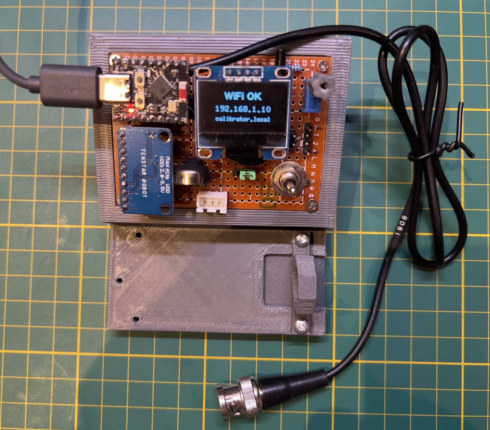
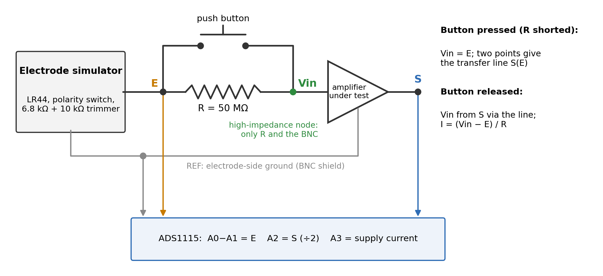
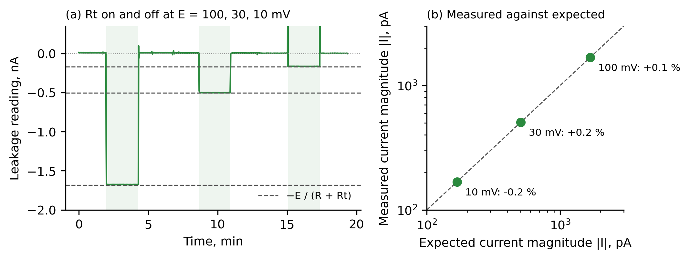
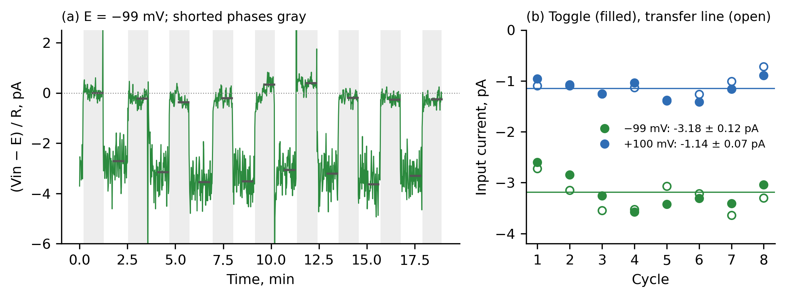

# ph-leakage-tester

Open hardware: a pH electrode simulator and leakage tester for in-circuit measurement of the
input current of a pH amplifier. A battery cell sets a known "electrode" voltage E, a known
series resistor R replaces the electrode, and the amplifier output gives the input current
from the drop across R. Verified with currents of 0.17 to 1.7 nA.

Description, build instructions, validation and limitations: see the paper
([`paper/HX_paper.md`](paper/HX_paper.md)).

## At a glance

*The tester on a 1 cm grid, with its BNC cable.*

*Principle: the simulator voltage E is measured before the series resistor R. With R shorted the input equals E and two points give the amplifier's transfer line; with R in circuit the input is recovered from the output and the current is (Vin − E)/R.*

*Check against known currents: a 9.73 MΩ resistor connected and removed at E = 100, 30 and 10 mV; measured currents agree with the calculated ones within 0.3 %.*

*Input current of the isolated amplifier by the toggle method: the button is pressed and released in phases of 30–60 s, and slow drift cancels.*

## Contents

| Folder | What is in it |
|---|---|
| `hardware/` | KiCad schematic and BOM of the tester; `enclosure/` has the STL files for printing |
| `firmware/` | PlatformIO firmware for the ESP32-C3 (copy `src/wifi_secret.example.h` to `src/wifi_secret.h` and fill in your own Wi-Fi; that file is never committed) |
| `tools/` | `calibrator_log.py` (CSV logger), `new_runs.py` (analysis of toggle and noise runs) |
| `analysis/` | `paper_numbers.py` recomputes every number in the paper from `data/` |
| `data/` | Raw measurement logs (CSV, never edited) with their own README |
| `figures/`, `photos/` | Figures of the paper and their scripts; photos without EXIF |
| `ph_board/` | The isolated pH amplifier used as the device under test: KiCad files, Gerbers, BOM |
| `LICENSES/` | Full texts of the licences below |

## Licences

- Hardware (KiCad, enclosure): CERN-OHL-S-2.0
- Firmware and scripts: GPL-3.0-or-later
- Documentation, figures and data: CC BY-SA 4.0

## Citation

Zenodo DOI: to be added after the first release.
