# pH electrode simulator and leakage tester for in-circuit estimation of amplifier input current

<!-- HardwareX version. Template: "HardwareX manuscript templates", Zenodo record 5078227 (version "July 2022", files HardwareX Template_20210707; checked 1 Nov 2026). The Guide for authors (sciencedirect.com) could not be opened for this check; confirm before submission that it still links this record. -->

**Authors:** Ihor Tkachenko* (ORCID: https://orcid.org/0009-0004-9167-9123)

**Affiliations:** Enamine Ltd., 67 Winston Churchill Street, Kyiv 02094, Ukraine.

**Corresponding author's email address and Twitter handle:** tigorlab@gmail.com

## Abstract

The input current of an amplifier shifts the reading of a glass pH electrode (100 MΩ to 1 GΩ):
1 nA through 500 MΩ is more than eight pH units. On an assembled board this current includes
leakage, and measuring it directly requires an electrometer on the input node. We present an
open-source tester that estimates this current in circuit, from the output of the board itself. A simulator voltage
reaches the amplifier through a 50 MΩ resistor with a shorting button. With the resistor
shorted, the tester records the amplifier's transfer line; with it in circuit, it recovers the
input voltage and indicates the current through the resistor. Toggling the resistor removes the
linear component of slow drift. Currents applied through a known resistor were recovered within
0.5 pA at 18–53 pA and within 0.19 % at 0.17–1.7 nA; the series resistor sets the scale to
±2.5 %. The absolute input current of a board was not established independently. Below about
10 pA the reading is only an indication: it shifted by 7–9 pA when only the ADC timing was
changed. On a commercial PH-4502C module, the tester revealed transfer-function nonlinearity.

## Keywords

pH measurement; input bias current; leakage test; electrode simulator; electrometer; open hardware

## Specifications table

| | |
|---|---|
| Hardware name | pH electrode simulator and leakage tester for in-circuit estimation of amplifier input current |
| Subject area | Chemistry and biochemistry; Engineering and materials science |
| Hardware type | Measuring physical properties and in-lab sensors |
| Closest commercial analog | We are not aware of a commercial instrument that measures the input current of a pH amplifier in circuit. Closest: pH/mV electrode simulators (e.g. Hanna HI8427, HI931001) and electrometers or picoammeters. |
| Open source license | Hardware: CERN-OHL-S-2.0; firmware and scripts: GPL-3.0-or-later; documentation and data: CC BY-SA 4.0 |
| Cost of hardware | About EUR 15 (components of the prototype; see Bill of materials) |
| Source file repository | https://github.com/igorlab/ph-leakage-tester (archive: https://doi.org/10.5281/zenodo.24111496) |

## 1. Hardware in context

Glass pH, ORP and ion-selective electrodes are read through amplifiers whose input must
draw almost no current. A combined glass electrode follows the Nernst equation with a slope
of 59.16 mV per pH unit at 25 °C [1, 2, 3], but its membrane has an internal resistance of
100 MΩ to 1 GΩ, higher at low temperature [2]. A current *I* drawn by the amplifier input
flows through this resistance and adds *I*·*R*el to the signal. At 1 pA and 500 MΩ the error
is 0.5 mV, below 0.01 pH; at 10 nA the linear estimate is 5 V, beyond the input range of
a typical amplifier, so the reading no longer follows the electrode (Figure 1). Input
current can therefore affect results derived from pH measurements. One example is carbonate
alkalinity titration, in which the sample is titrated to an end point near pH 4 [4].

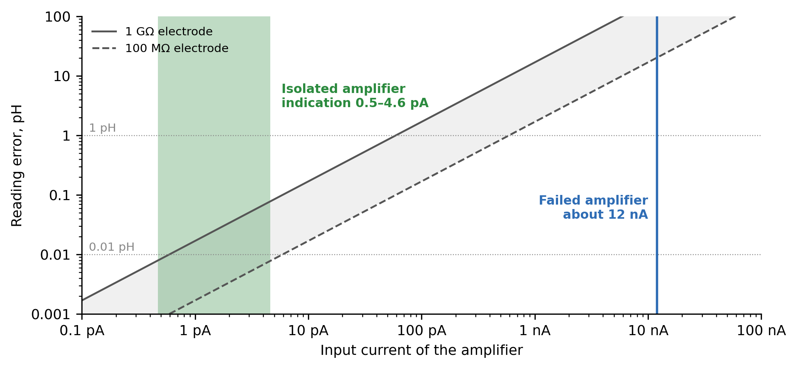

*Figure 1. Reading error in pH units against the input current of the amplifier, for an
electrode of 100 MΩ (dashed) and 1 GΩ (solid); errors of several pH units lie outside the
linear range of a real electrode and amplifier and only mark that limit. Blue line: the failed
amplifier, about 12 nA (preliminary observation, Section 7.6). Green band: indications on the
isolated amplifier, 0.5–4.6 pA in magnitude, from toggle runs at ±100 mV on two days
(Section 7.4).*

The input current of an assembled amplifier is not only a property of its operational
amplifier: flux residue, contamination, protection components and layout can each add
leakage [5]. A datasheet value of a few femtoamperes is therefore necessary but
insufficient to characterize a finished board.

Measuring this current is difficult with common tools. Electrometers and picoammeters [5]
are expensive and need access to the high-impedance node. Commercial pH simulators set a
voltage; some, such as the Hanna HI8427, also check cables and connectors for leakage with
a sensitivity of 10⁹ Ω [6], but they do not measure the current drawn by the meter.
Classic simulators take the same approach; the I-02 (1988) examined here (Figure 2a)
contains a Weston standard cell and resistor decades and can insert 500 or 1000 MΩ in series
to imitate the glass. A leaky input is recognized by comparing readings with and without
this resistance, manually and without a number for the current. The same principle, a large resistor in series with the
input that a switch shorts, with the current inferred from the change of the output, is the
standard bench test for the input bias current of an operational amplifier [7, 8]; there it
is applied to a bare amplifier in a dedicated test circuit, not to a finished board, and
below about 5 pA it is considered difficult because of the large resistors required [8]. To the
best of our knowledge, no open, low-cost instrument measures the input current of a pH
amplifier in place.

[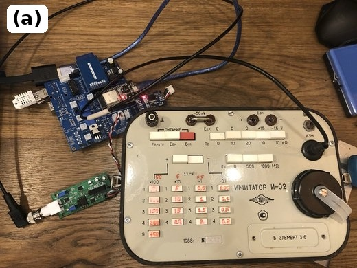](../photos/i-02.jpg)
[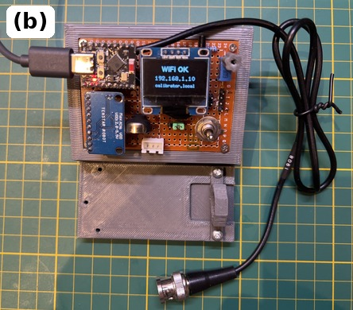](../figures/photo_calibrator.jpg)

*Figure 2. (a) The I-02 electrode simulator (1988): a Weston standard cell, decades of
resistors and switchable series resistances of 500 and 1000 MΩ. (b) The tester described
here, on a 1 cm grid, with its BNC cable; the display shows the network address of its web
page.*

Published open pH hardware reads the output of a commercial meter [9], uses a commercial
ISFET sensor and analyzer [10], or an Atlas Scientific EZO pH circuit on an electrically
isolated carrier board [11], a closed design sold as two parts, about USD 46 for the circuit and
USD 42 for the carrier board [12]; we found no report of the input current of the interface
in these articles.

This work was motivated by an early amplifier built for an alkalinity titrator: its input
drew about 12 nA, and a working electrode did not change the board's output. We present a
tester (Figure 2b) that automates and quantifies the series-resistance test. It produces an
arbitrary voltage *E* from an LR44 cell and measures it with an ADS1115 before a 50 MΩ
series resistor, while the same ADC reads the amplifier output *S*. With the resistor
shorted, two points give the amplifier's transfer line; with the resistor in circuit, the
input recovered from *S* differs from *E* by the drop across the resistor. The amplifier
under test thus serves as the voltmeter of its own input. The tester applies the
bench-test principle to a finished board and infers the current from the board's own
output. It provides continuous logging and a switching protocol that removes the linear
component of slow drift; separate measurements with the resistor shorted assess the
nonlinearity of the transfer function. The recovery of currents of 18 pA to 1.7 nA applied
through a known resistor was verified (Section 7.3), and the tester was applied to three test
cases: the failed amplifier, the isolated amplifier and a commercial PH-4502C module; a board
of the isolated revision runs in the titrator (Section 7.7). The absolute input current of a
board, separated from the tester's own contribution, was not established. The components of
the prototype cost about EUR 15 (Section 4). The principle of using an amplifier to measure its
own input current through a switched series resistor is known [7, 8]; the contribution of this
work is its open implementation for assembled pH boards, the switching and logging protocol,
the open data and an experimental account of the limits of the method.

## 2. Hardware description

The tester estimates the input current of an amplifier through the amplifier's own
output (Figure 3). The measurement principle and the quantities reported are described
first, then the hardware and firmware.

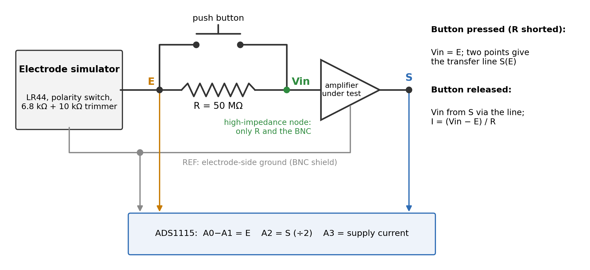

*Figure 3. Measurement principle. The simulator voltage E is measured before the series
resistor R and reaches the amplifier input through it. With the button pressed (R shorted)
the input equals E, and two points give the amplifier's transfer line S(E). With the button
released, the input Vin is recovered from the output S through that line, and the input
current is I = (Vin − E)/R. Only R, the button, the BNC and the test pin TP3 connect to the high-impedance node; no ADC input does.*

**Measurement principle.** With the button pressed, the amplifier input equals *E*. Two
points (*E*1, *S*1) and (*E*2, *S*2), usually at about +100 and −100 mV, define the amplifier's
transfer line: gain = (*S*2 − *S*1)/(*E*2 − *E*1) and zero = *S*1 − gain·*E*1. Each point is taken
after a 30 s pause. Two points define a line but do not show that the amplifier is linear
between them: the method assumes an amplifier that is linear, settled and not saturated, and
whose transfer line does not change between calibration and measurement; Section 7.2 checks
this for the amplifier tested. With the button released, the amplifier input is recovered
from its own output as *V*in = (*S* − zero)/gain, and the current through the
series resistor follows from the voltage drop across it, *I* = (*V*in − *E*)/*R*. A negative
current flows from the tester through *R* into the input node of the amplifier, as it does
through a resistor connected from the input to the reference (Section 7.3); a positive current
flows out of the input node.

Small currents are evaluated by toggling the button at fixed *E* in phases of 30–60 s. For
each open phase, the mean of *V*in − *E* in the two neighboring shorted phases is subtracted
from its open-phase value, and the difference is divided by *R*. Because all phases have the
same length, this mean is the linear interpolation of the shorted state to the middle of the
open phase; phases of unequal length would need time weights. After the button is switched
the output settles within a few seconds, and the first 10–30 s of each phase are discarded.
The electrical time constant of *R* with a cable capacitance of the order of 100 pF is only
about 5 ms; the settling is attributed to the filter and to the disturbance of handling the
button, which were not separated. Slow drift appears in both states; the interpolation removes
its linear component, but not nonlinear drift, a step of the zero or an effect present in only
one state, such as a change correlated with pressing the button (Section 7.5). The logger
guides the operator through the phases (`tools/calibrator_log.py -g toggle`).

**Quantities reported.** Four quantities are distinguished in this paper. (i) The *indicated
current*, (*V*in − *E*)/*R*, is what the firmware displays; any error of the recovered input
voltage appears in it as an equivalent current. (ii) The *toggle current* is the indicated
current of an open phase minus the interpolated indicated current of the neighboring shorted
phases; it removes the linear component of slow drift of the transfer line. (iii) The
*recovered applied current* is the current drawn through a known test resistor *R*t connected
across the amplifier input, obtained as *I*(with) − *R*t/(*R* + *R*t)·*I*(without) (Section 7.3);
it is the quantity validated against a calculated current. (iv) The *absolute input current of
the board* is the current drawn by the board alone. It is not established independently in
this work: the indicated and toggle currents also contain any current of the tester's own input
node and connections, and effects of the acquisition timing of up to about 9 pA (Section 7.5).
Where the text speaks of the input current of a board, it means the toggle or indicated current
with these limitations.

**Tester.** The tester (Figures 4 and 5) combines an electrode simulator with a
measuring unit. The simulator consists of an LR44 cell, a DPDT ON-OFF-ON switch wired for
polarity reversal, a 6.8 kΩ resistor and a 10 kΩ trimmer, whose wiper provides the
simulator voltage *E*. *E* reaches the BNC center through a series resistor *R* of 50 MΩ (five
10 MΩ 5 % resistors, size 1206, soldered end to end and standing clear of the board), which a push button shorts during calibration. The
simulator floats: its low side takes its potential from the amplifier under test, as a
real electrode does, so the simulator voltage channel is valid only with an amplifier
connected.

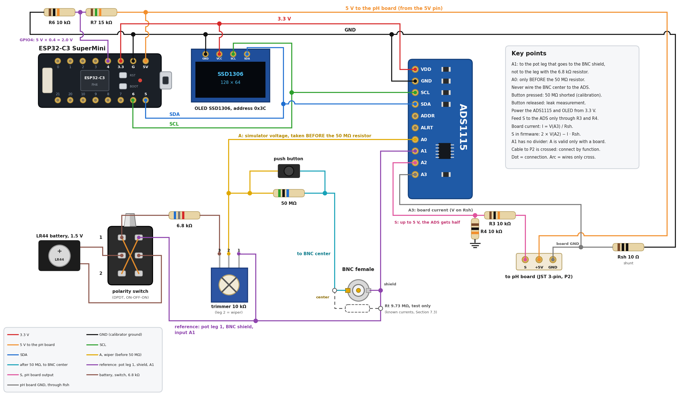

*Figure 4. Schematic of the tester, including USB-supply measurement on GPIO4
(KiCad source in `hardware/`). Wire by the pin names printed on the modules. Dashed: the test
resistor Rt, connected from the BNC center to the shield only for the known-current checks
of Section 7.3; it is not part of the tester.*

[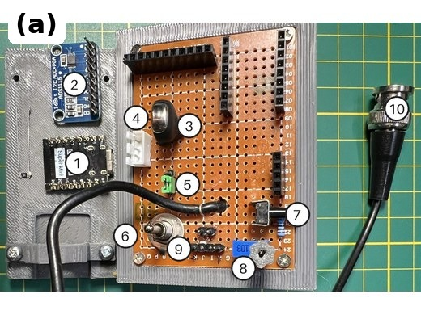](../figures/photo_calibrator_inside.jpg)
[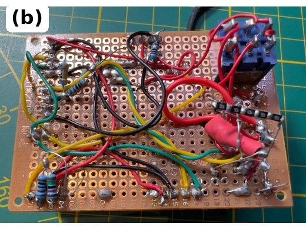](../figures/soldering.jpg)\
[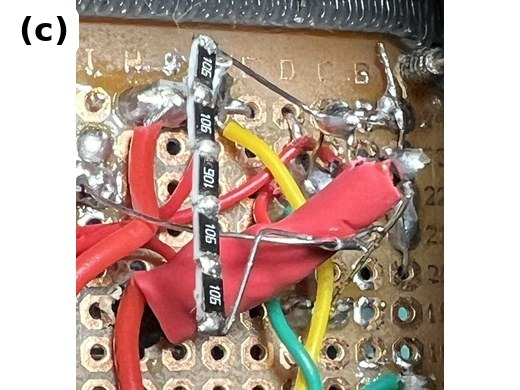](../figures/photo_r50m.jpg)
[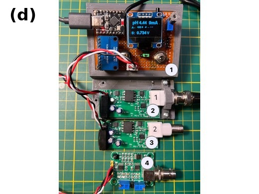](../figures/photo_boards.jpg)
[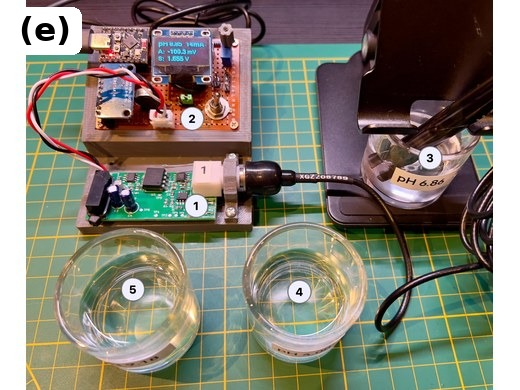](../figures/photo_setup_f.jpg)

*Figure 5. The tester. (a) The tester consists of (1) ESP32-C3 Super Mini, (2) ADS1115, (3) LR44
cell, (4) J2 to the amplifier, (5) JP1, supply jumper for the amplifier, set to 5 V, (6) polarity switch, (7) button
shorting R, (8) trimmer setting E, (9) test pins, (10) BNC plug. (b) The series resistor R
and point-to-point wiring on the underside of the perfboard. (c) Close-up of R, standing
clear of the perfboard. (d) (1) The tester, (2, 3) two isolated amplifiers and
(4) a PH-4502C module. (e) Buffer test setup: (1) isolated
amplifier, (2) tester, (3) electrode and (4, 5) the other buffer solutions.*

An ADS1115 [13] measures *E* differentially before the series resistor (inputs A0–A1,
±2.048 V range), the amplifier output *S* through a 10 kΩ / 10 kΩ divider (A2, ±4.096 V
range) and the supply current of the amplifier on a 10 Ω shunt in its ground return (A3,
±0.512 V range). A 15 kΩ / 10 kΩ
divider scales the USB 5 V rail by 0.4 for measurement on the ESP32-C3's GPIO4 ADC input;
its calibration factor is stored in non-volatile memory. The node after the
series resistor is never connected to the ADC, because the ADC input would itself become
the leakage being measured. The amplifier under test is supplied from the tester at
5 V; a jumper (JP1) on the prototype also offers 3.3 V, which was not used and is not shown
in Figure 4. An ESP32-C3 SuperMini runs the firmware, and an SSD1306
OLED displays the readings. Each channel averages 25 samples taken at 250 samples/s, which takes about
116 ms, and the channels are read in the order *E*, *S*, supply current, with no pause between *E* and *S*.
One measurement cycle takes about 0.4 s. These settings are fixed in the published firmware; the
low-current results of Sections 7.3–7.5 apply to them, and other acquisition settings change the indication. *E* and *S* are then smoothed by an adaptive exponential filter (weight 0.35
per cycle, bypassed for steps larger than 0.4 mV in *E* or 3 mV in *S*) before the current is
computed. Because the shunt lies in the ground return, the voltage read on A2 includes the
drop *I*supply × 10 Ω; the firmware subtracts it point by point, *S* = *S*raw − *I*supply × 10 Ω.
For the isolated amplifier, whose supply current rises with its output, the correction
changes the apparent gain from −6.44 to −6.09 V/V. As long as the supply current depends on
the output in the same way during calibration and measurement, the correction transforms *S*
in the same way in both, so the recovered *V*in and the current are unchanged; the reported gain
does change. On the ±4.096 V range, one ADC count is 125 µV, equivalent to 250 µV at *S* before
the divider. With a gain magnitude of about 6 V/V and *R* = 50 MΩ, this corresponds to
approximately 40 µV at the amplifier input, or 0.8 pA. The firmware rounds the mean of each
reading of *S* to a whole count; averaging over successive readings brings the statistical
resolution below one count (Section 7.4).

**Software.** The ESP32 serves a web page (English and Ukrainian) with the readings, the
calibration line, time charts of the input current and an equilibrium timer for real
electrodes. For measurements, a host script (`tools/calibrator_log.py`) polls the same data
once per second and writes a CSV file. The firmware and its web page keep the working name “pH Calibrator” (host name `calibrator.local`). The main numbers reported below can be recomputed from
the CSV files with `analysis/paper_numbers.py` (Section 3).

The tester can help other researchers to:

- estimate the input current of a finished pH amplifier in place, without connecting a
  separate measuring instrument to its high-impedance node;
- check the transfer function for nonlinearity with the series resistor shorted, separately
  from the indication with it in circuit, and show pickup, which a single reading combines;
- check an amplifier before installation, after repair or cleaning, or when its readings
  drift;
- log the indicated current continuously, for leakage that changes with time or humidity;
- demonstrate during teaching how electrode resistance and input current corrupt pH readings.

The method is expected to apply, under the same electrical conditions, to other voltage-input
electrometer amplifiers with a linear transfer function, such as amplifiers for ORP and
ion-selective electrodes and hydroponics sensors; it was demonstrated here on pH amplifiers
only. It does not
apply to transimpedance amplifiers (photodiode or ionization-chamber amplifiers), whose
input is held at virtual ground. The amplifier must run from the tester's single 5 V supply.
The ADS1115 runs from 3.3 V, so for a valid conversion the voltage on each of its inputs
A0–A3 must stay between the tester's ground and 3.3 V (absolute maximum −0.3 to 3.6 V) [13];
the selected full-scale range does not extend these limits. The reference of the amplifier
input (A1) and the simulator voltage on top of it (A0) must therefore lie within 0–3.3 V,
and the amplifier output must stay within 0–6.6 V, so that it is within 0–3.3 V after the
1:2 divider (A2); an amplifier supplied with 5 V meets the latter. Separately, the
differential voltage *E* = A0 − A1 must stay within the ±2.048 V range, which a single LR44
cell (1.5 V) cannot exceed. The
series resistance is entered on the web page, and the gain and zero are measured rather
than assumed, so other gains need no firmware changes.

## 3. Design files summary

The hardware is released under a license that follows the Open Source Hardware definition [14]. The design files, firmware, scripts and raw data are archived at Zenodo [15].

| Design file name | File type | Open source license | Location of the file |
|---|---|---|---|
| `hardware/calibrator.kicad_sch` | KiCad schematic | CERN-OHL-S-2.0 | https://doi.org/10.5281/zenodo.24111496 |
| `figures/fig_calibrator_schematic.png` (drawn by `fig_calibrator_schematic.py`) | Wiring diagram (PNG) and the Python script that draws it | CC BY-SA 4.0 (script: GPL-3.0-or-later) | https://doi.org/10.5281/zenodo.24111496 |
| `hardware/enclosure/pH-tester.STEP`, `pH-tester.STL` | Enclosure, 3D model: STEP for editing, STL for printing (82 × 107 × 41 mm) | CERN-OHL-S-2.0 | https://doi.org/10.5281/zenodo.24111496 |
| `hardware/enclosure/board_holder.STEP`, `board_holder.STL` (STEP drawn by `make_board_holder.py`) | Board holder, 3D model: STEP for editing, STL for printing (6 × 38 × 18 mm), and the FreeCAD script that rebuilds the STEP | CERN-OHL-S-2.0 (script: GPL-3.0-or-later) | https://doi.org/10.5281/zenodo.24111496 |
| `firmware/` (`src/main.cpp`, `platformio.ini`) | Firmware source (C++, PlatformIO) | GPL-3.0-or-later | https://doi.org/10.5281/zenodo.24111496 |
| `tools/calibrator_log.py` | Python data logger | GPL-3.0-or-later | https://doi.org/10.5281/zenodo.24111496 |
| `tools/new_runs.py`, `analysis/paper_numbers.py` | Python analysis scripts | GPL-3.0-or-later | https://doi.org/10.5281/zenodo.24111496 |
| `data/` | Raw measurement logs (CSV) with README | CC BY-SA 4.0 | https://doi.org/10.5281/zenodo.24111496 |
| `hardware/calibrator_bom.xlsx` | Bill of materials (spreadsheet) | CC BY-SA 4.0 | https://doi.org/10.5281/zenodo.24111496 |
| `ph_board/` | The isolated pH amplifier used as the device under test (Section 7.2): KiCad project, Gerber files, BOM, schematic PDF and README; not part of the tester | CERN-OHL-S-2.0 | https://doi.org/10.5281/zenodo.24111496 |

`hardware/calibrator.kicad_sch` is the editable schematic of the tester.
`figures/fig_calibrator_schematic.png` shows the same circuit as a wiring diagram of the
modules (Figure 4) for point-to-point assembly. The enclosure holds the perfboard, the
modules and the BNC plug; the enclosure and the board holder are given as STEP files for
editing and as STL files for printing. The firmware runs on the ESP32-C3, reads the ADS1115, computes the
transfer line and the current, drives the OLED and serves the web page. `calibrator_log.py`
records the readings once per second to CSV and guides toggle runs. `new_runs.py` analyzes
toggle and noise runs; `paper_numbers.py` recomputes from the CSV files in `data/` the known currents
(Tables 2 and 3), the noise floor, the toggle runs of 28 October, the PH-4502C, buffer and
titrator results and the values transcribed for the failed amplifier; the other numbers come
from the logs named in the text. The README of `data/` documents each protocol and the
correction for the series resistance. `hardware/calibrator_bom.xlsx` is the bill of materials of Section 4 as a
spreadsheet. `ph_board/` holds the design of the isolated pH amplifier that served as the
device under test, including the manual rework to the REF3040 reference (Section 7.2); it is
not needed to build the tester.

## 4. Bill of materials summary

| Designator | Component | Number | Cost per unit - EUR | Total cost - EUR | Source of materials | Material type |
|---|---|---|---|---|---|---|
| U1 | ESP32-C3 SuperMini | 1 | 1.47 | 1.47 | AliExpress, 10 pcs for EUR 14.69 (Jan 2026) | Semiconductor |
| U2 | ADS1115 16-bit ADC module | 1 | 3.23 | 3.23 | Amazon, 3 pcs for EUR 9.69 | Semiconductor |
| U3 | SSD1306 128×64 I²C OLED display | 1 | 3.66 | 3.66 | Amazon, 3 pcs for EUR 10.99 | Semiconductor |
| BT1 | LR44 cell and holder | 1 | 1.00 | 1.00 | Cell bought for EUR 1; holder salvaged from an old toy | Non-specific |
| SW1 | DPDT ON-OFF-ON toggle switch (polarity); gold-plated contacts recommended (Section 5) | 1 | 2.00 | 2.00 | Purchased, EUR 2 | Non-specific |
| SW2 | Push button shorting R2 | 1 | 0.05 | 0.05 | AliExpress, 6×6 mm tactile switches, 20 pcs for EUR 0.92 | Non-specific |
| RV1 | 10 kΩ trimmer potentiometer | 1 | 0.09 | 0.09 | AliExpress, 3296W, 20 pcs for USD 1.84 (2022) | Non-specific |
| R1 | Resistor 6.8 kΩ | 1 | 0.006 | 0.01 | AliExpress, 1/4 W metal-film assortment, 100 pcs for EUR 0.58 | Non-specific |
| R2 | Resistor 10 MΩ, 5 %, 1206 (five in series, 50 MΩ) | 5 | 0.017 | 0.09 | AliExpress, 1206 SMD assortment, 100 pcs for EUR 1.70 | Non-specific |
| R3, R4 | Resistor 10 kΩ (divider for *S*) | 2 | 0.006 | 0.01 | as R1 | Non-specific |
| R5 | Resistor 10 Ω (supply-current shunt; Rsh in Figure 4) | 1 | 0.006 | 0.01 | as R1 | Non-specific |
| R6, R7 | Resistors 10 kΩ and 15 kΩ (USB voltage divider) | 2 | 0.006 | 0.01 | as R1 | Non-specific |
| J1 | BNC plug (male) with cable | 1 | 0 | 0 | Salvaged from an old electrode | Metal |
| J2 | JST 3-pin connector and cable to the amplifier | 1 | 0.84 | 0.84 | AliExpress, XH2.54 kit of 230 pcs for EUR 0.84 (whole kit) | Non-specific |
| JP1 | 3-pin header and jumper (amplifier supply, set to 5 V) | 1 | 0.088 | 0.09 | AliExpress, pin-header strips, 100 pcs for EUR 8.79 | Non-specific |
| TP1–TP3 | Test pins (REF, E, VIN) | 3 | 0.088 | 0.26 | as JP1 | Metal |
| – | Perfboard | 1 | 1.50 | 1.50 | Amazon, 5×7 cm | Composite |
| – | 3D-printed enclosure (PLA, 35 g) | 1 | 0.63 | 0.63 | PLA filament, EUR 18 per kg | Polymer |
| | **Total** | | | **14.95** | | |

Designators are those of the KiCad schematic (`hardware/calibrator.kicad_sch`). Unit prices of parts bought in packs are given to three decimals, so that the unit price times the number of parts rounds to the printed total; the printed totals sum to EUR 14.95.

The 10 MΩ resistors are ordinary thick-film parts. Their tolerance does not affect the
result, because the sum of the five is measured and entered on the web page (Section 5); their
stability with temperature and time was not assessed. The total is the cost of the components
of this prototype at the pack prices paid; salvaged parts are counted at zero, and tools, the
multimeter and shipping are not included.

## 5. Build instructions

The tester is built from ready-made modules wired point-to-point on perfboard
(Figures 4 and 5). The author built the prototype in about one day, including printing the
enclosure, soldering, flashing and checking; no independent build has been made.

1. **Power and digital part.** Mount the ESP32-C3, the ADS1115 and the OLED. Supply the
   ADS1115 and the OLED from the 3.3 V pin of the ESP32-C3, never from 5 V: 5 V on the I²C
   bus would damage the ESP32-C3. Connect SDA and SCL as in Figure 4 and tie ADDR of the
   ADS1115 to GND (address 0x48). Connect the USB voltage divider (R6, R7) to GPIO4.
2. **Measurement channels.** Connect A0 to the trimmer wiper (the simulator voltage *E*,
   before the series resistor) and A1 to the reference leg of the trimmer, which is also
   the BNC shield. Feed the amplifier output *S* to A2 only through the R3/R4 divider. Insert
   the 10 Ω shunt R5 (Rsh in Figure 4) in the ground return of the amplifier and connect its upper end to A3.
   Never connect the node after the series resistor to the ADC: the ADC input would itself
   become the leakage being measured.
3. **Electrode simulator.** Wire the LR44 cell to the DPDT switch for polarity reversal
   (the center position switches the cell off), then through the 6.8 kΩ resistor to the
   10 kΩ trimmer, whose wiper gives *E*. The switch carries only the current of this
   divider, about 90 µA at 1.5 V, through both of its poles in series. The general-purpose
   toggle switch of the prototype often failed to make contact and had to be flipped many
   times, presumably because this current is too small to break through the film on its
   contacts; a switch with gold-plated contacts, rated for low-level (dry) circuits, is
   recommended. A contact that has not closed is seen at once as a wrong reading of *E*. Once
   *E* is steady, such a contact does not bias the current, which is computed from the measured
   *E*; the transient after the switch is moved is a separate effect (Section 7.5).
4. **Series resistor R.** Solder five 10 MΩ 1206 resistors end to end so that the chain
   stands clear of the perfboard (Figure 5c), and connect the push button across the whole
   chain. Keep the node between *R* and the BNC center off the perfboard. Before connecting
   the chain, measure each resistor separately on the 40 MΩ range of a multimeter without
   touching the probe tips (the body resistance in parallel lowers the reading) and use the
   sum as *R*.
5. **Cable to the amplifier.** The cable between the tester (GND, supply, S) and the
   amplifier connector P2 (VCC, com, S) is crossed; connect it by function and check it
   before the first power-up.
6. **Cleaning.** Wash the flux off around the series resistor, the button and the BNC,
   because these nodes carry picoampere currents.
7. **Firmware.** Build and upload the firmware with PlatformIO (pioarduino platform
   55.03.312-1, Arduino core 3.3.12, ESP-IDF 5.5.5; the results were obtained with Adafruit ADS1X15
   2.6.2, Adafruit BusIO 1.17.4, U8g2 2.36.18, AsyncTCP 4.0.0 (git 02c90b8) and ESPAsyncWebServer
   3.12.1 (git fddcc60); `platformio.ini` pins these versions).
   Wi-Fi credentials go in `src/wifi_secret.h`, which is not part of the repository.

*Design decisions.* The series resistance of 50 MΩ is a compromise: a larger value increases
the sensitivity, but it also increases, in proportion, the voltage that any leakage of the
wiring, the push button and the operator's hands produces at the input node, which would then
call for guarding, PTFE insulation and a shielded enclosure [5]. This trade-off was not
quantified.

*Safety.* No voltage exceeds 5.5 V. The galvanic isolation is functional (it breaks ground loops
through the water), not a safety barrier.

## 6. Operation instructions

1. Connect the amplifier under test to the BNC plug and its connector P2 to the tester
   cable. The tester supplies the amplifier with 5 V.
2. Power the tester from USB. The display shows its network address (Figure 2b), and the
   web page opens at `calibrator.local` (Figure 6). Enter the measured series resistance
   in “Resistor R, MΩ” and press “Save R”.
3. **Transfer line.** Press and hold (or tape) the button. Set *E* to about +100 mV with the
   polarity switch and the trimmer (reading “A” at the top of the page; if “A” stays near
   zero after the switch is flipped, the switch has not made contact), wait 30 s and press
   “Capture point 1”; repeat at about −100 mV with “Capture point 2”. The page shows the
   gain and zero of the line.
4. **Input current.** Release the button and keep hands away from the BNC, the cable and the
   resistor. The page shows the leakage current, a comparison with a user-set limit
   (“Leak norm, nA”) and a time chart. Read it by its magnitude: a current of nanoamperes
   identifies a faulty board; at tens of picoamperes, trust differences between readings
   (for example before and after cleaning) more than the absolute value; below about 10 pA,
   the reading shows only that the current is of the order of picoamperes, and a limit within
   this range cannot be checked, because the indication may be shifted by as much (Section 7.5).
5. **Small currents.** Below about 10 pA, use toggle runs, which remove the linear component of slow drift of the zero:
   `python3 tools/calibrator_log.py -o run.csv -g toggle -n 8 -p 60` guides the operator
   through shorted and open phases with a countdown and a beep, and
   `python3 tools/new_runs.py toggle run.csv` gives the current of each cycle. Tape the
   button rather than holding it, and wait at least 15 min after flipping the polarity switch
   (Section 7.5).
6. **Logging.** `python3 tools/calibrator_log.py -o run.csv` records all readings once per
   second; typed notes are stored as marks. The page also keeps about 14 h of history in the
   browser, which “Download CSV” saves.

The second block of the page converts the amplifier output to pH with a three-buffer
electrode calibration; it is not needed to measure the current.

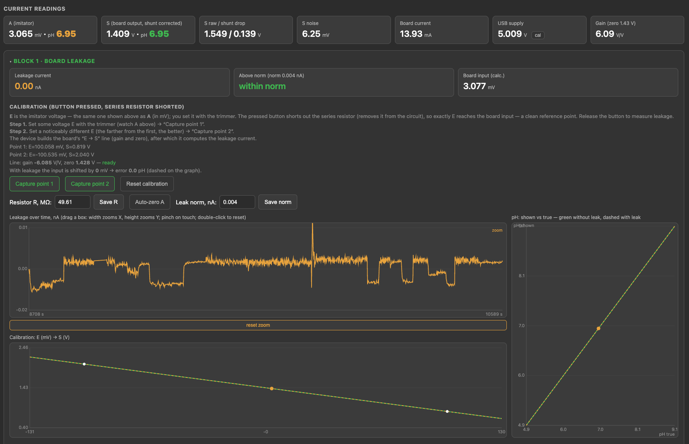

*Figure 6. Web page of the tester, block 1 (board leakage): current readings, the
two-point transfer line, the series resistance and the leakage limit, the leakage current
over time and the transfer line E → S.*

The tester works below 5.5 V and presents no high-voltage hazard, but the construction and
low-leakage precautions still apply: keep the high-impedance node clean and dry, and keep
the ADS1115 and the OLED on 3.3 V (Section 5, step 1).

## 7. Validation and characterization

### 7.1 Test configuration and measured quantities

The tests are reported in the order of the questions they address: whether the voltages are
read correctly and the transfer line holds (Section 7.2), whether applied currents are
recovered (7.3), how repeatable the indication is (7.4), which systematic effects limit its
interpretation (7.5), what the tester shows on a failed and a commercial board (7.6) and how
the tested amplifier performs in its application (7.7). Table 1, at the end of this
subsection, maps each test to the quantity it assesses and to its limitations; the quantities
are those defined in Section 2.

**Device under test.** Most tests used a galvanically isolated pH amplifier built for
the titrator (directory `ph_board/` of the repository). It is a revision of the interface shared by Franck
("Bubule") on cap-recifal.com in 2011 [16]: a CMOS input stage (LMC6042 [17], measured gain −6.09 V/V, Section 7.2),
an HCNR201 analog optocoupler in the servo-photodiode configuration [18] and an isolated
DC-DC converter. With the original values, the input stage of our earlier builds burned out
when the electrode was disconnected; the cause of these failures was not investigated. The
revision tested here has fixed resistors in place of the trimmers, the LED series resistor
raised from 255 to 470 Ω, the servo-loop and output capacitors increased from 10 pF to 56 nF
and 1 µF, and a new layout; these changes are reported as the history of the builds, and
whether they prevent the failure was not tested. The tested
board also takes its reference from a REF3040 [19] and has its input pin wired in air to
the BNC center (Figure 7). With the electrode of Section 7.7 its output *S* was 0.46 V in the
pH 4.00 buffer and 2.22 V in the pH 9.18 buffer. Two boards were tested. All results below are from one of them with the REF3040 reference,
except where the second board or the divider reference is named. With its reference taken from
the +5 V rail through a resistive divider, the same board appears in the supply-sensitivity
comparison and served as the amplifier in the earlier known-current check (Section 7.3). Component values and the rework are documented
in the repository. The amplifier serves here only as a device under test.

[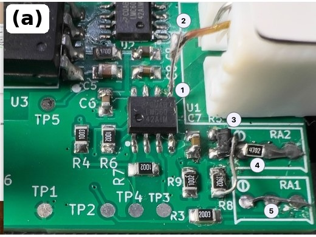](../figures/photo_board_input.jpg)
[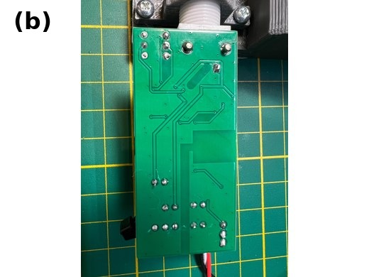](../photos/board_a_bottom.png)

*Figure 7. The amplifier board reworked for the REF3040 reference. (a) Component side:
(1) input pin 5 of the LMC6042, lifted from the board; (2) flying wire from this pin to
the BNC center; (3) REF3040 voltage reference; (4) 47 kΩ resistor on RA2; (5) wire link in
place of RA1. (b) Underside of the same board, showing the isolation gap between the
electrode and station sides.*

**Calibration of the tester.** Apart from the measurement of *R* (Section 5), the stored
factor of the USB-voltage channel (Section 2) and the check of *E* in Section 7.2, the tester
needs no calibration of its own: the gain and zero of the amplifier are taken anew as a
two-point line before every series, to capture them at the time of measurement.

**Provenance of the data.** Four facts that may affect how the logs are
read. (1) Logs recorded before 28 October 2026 used firmware that truncated the averaged *E* to
whole ADC counts (62.5 µV, up to 1.3 pA at *R* = 49.61 MΩ). These are the simulator-voltage
check, the linearity and supply sweeps, the buffer run and the check of the transfer line after
it, the isolation test, the earlier known-current check (Section 7.3) and the PH-4502C sweeps.
The truncation matters only where *E* or a small current is evaluated, that is in the earlier
known-current check, the linearity sweep and the PH-4502C currents; none of these was repeated
with the final firmware.
(2) The earlier known-current check and the historical supply comparison used the board before
its rework to the REF3040 reference (divider reference). (3) The logs of the earlier check were
recorded with an incorrect value of *R* in the firmware and were rescaled (Section 7.3).
(4) The tests of acquisition timing in Section 7.5 used a temporary firmware that is not part of
the published design. All other results were obtained with the final, published firmware.

*Table 1. Map of the tests of this section.*

| Test | Section | n | Firmware | Quantity assessed | Limitation |
|---|---|---|---|---|---|
| Simulator voltage | 7.2 | 5 points | truncated *E* (not relevant at this resolution) | *E* against a multimeter, ±200 mV | multimeter resolution |
| Linearity (Figure 8) | 7.2 | one sweep | truncated *E* | output linearity, about 0.1 mV at the input | resolution of *E*; not repeated with the final firmware |
| Supply sensitivity (Figure 9) | 7.2 | one sweep per board | truncated *E* (*E* constant; *S* evaluated) | output change per volt of supply | *S* logged with 1 mV resolution |
| Known currents (Table 2) | 7.3 | 7 voltages, 12 points | final | recovered applied current, 18 pA – 1.7 nA, against a calculated current | differences only; correction for the node's own current; node resistance 8.13 MΩ; same multimeter for *R* and *R*t |
| Known currents, earlier check (Table 3, Figure 10) | 7.3 | 3 voltages | truncated *E* (before 28 Oct) | 0.17–1.7 nA against a calculated current | same multimeter for *R* and *R*t; earlier divider board |
| Noise floor (Figure 11) | 7.4 | two one-hour runs | final | repeatability, 0.06–0.1 pA at 1 min | accuracy not assessed; not validated below 18 pA |
| Toggle runs (Table 4, Figure 12) | 7.4 | 2 × 8 cycles on each of two days | final | toggle current, −4.6 to +0.5 pA | includes the tester's node; state-dependent bound; 1.4–1.6 pA between days |
| Polarity history | 7.5 | runs of 15 min per switch position | final | transient after a flip of the polarity switch | origin not identified |
| Acquisition timing | 7.5 | two voltages; one run with *R*t | temporary diagnostic | shift of the indication with ADC timing, 7–9 pA | mechanism not identified; not bounded |
| Failed amplifier | 7.6 | 7 voltages | earlier | indicated current, about 12 nA | values transcribed, raw log not preserved; preliminary |
| PH-4502C (Figure 13a,b) | 7.6 | one sweep per direction | truncated *E* | nonlinearity with *R* shorted; currents preliminary | opposite sweep directions |
| Isolation (Figure 13c) | 7.6 | one run per module | truncated *E* | qualitative ground coupling | hand-marked phases; not quantitative |
| Titrator (Figure 14) | 7.7 | 208 hourly results | – | repeatability of the whole titrator | accuracy not assessed; not the amplifier alone |

### 7.2 Voltage readout and transfer-function checks

**Simulator voltage.** The simulator voltage was checked against a Mastech MS8229 multimeter at the BNC with the
button pressed (protocol C,
`data/C_channel_A.csv`). Over ±200 mV (five points) the slope was 1.0003 ± 0.0006
(standard error), equal to 1 within its uncertainty, and the offset −0.06 mV; the largest difference, 0.2 mV (0.003 pH), is within the multimeter's last digit.

**Transfer line.** The transfer line of the isolated amplifier was taken after a 30 s pause at each point, at
about ±155 mV for the runs of 26 October (linearity, buffers, isolation) and at about
±100 mV for the toggle and one-hour runs of 28 October. In a check after the buffer run,
the recovered input differed from *E* by −0.13 mV at −99 mV and −0.03 mV at +100 mV
(`data/F_final_check_visible.csv`), 0.002 pH or less.

**Linearity of the isolated amplifier.** The two-point line assumes that the amplifier is linear
between and beyond its points; this sweep checks that assumption. With the tester correcting
the voltage drop across its 10 Ω
supply-current shunt, eight stable points from −201.0 to +219.9 mV gave a gain of
−6.0867 V/V and a zero of 1.42810 V; the largest output residual was 0.402 mV, or
66 µV (0.001 pH) referred to the input (`data/A_REF3040_linearity_2026-10-26_run2.csv`, Figure 8).
Each point averages the readings within 0.25 mV of one set level; three further plateaus
(+199.6, +150.0 and −199.4 mV) lie on the same line and were not used. At +250.1 mV the
output reached the lower rail and was excluded from the fit; the transfer line is valid only
within the linear range, about −200 to +220 mV for this amplifier. The firmware used for this
log truncated the averaged *E* toward zero by up to 62.5 µV. The truncation error had opposite
signs at positive and negative *E*. Because this error is comparable to the fit residual, the
linearity is reported only as better than approximately 0.1 mV.

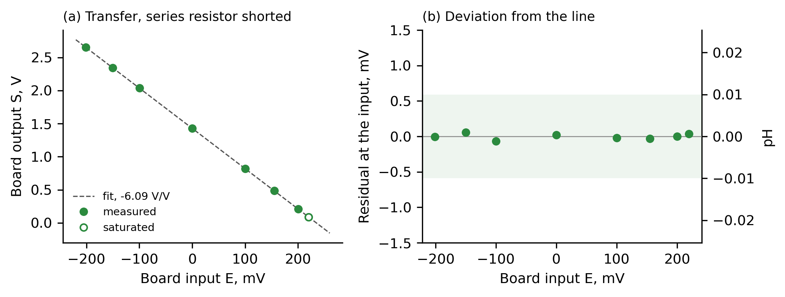

*Figure 8. Linearity of the isolated amplifier with the series resistor shorted.
(a) Output S against input E with the fitted line; open circle: beyond the linear range.
(b) Deviation from the line, referred to the input, in mV and in pH; shaded: ±0.01 pH.*

**Supply sensitivity.** The REF3040 revision showed negligible supply sensitivity, whereas the same board before the rework (divider reference)
showed a large one (Figure 9). In a
supply sweep over six levels from 4.72 to 5.52 V at *E* = −155 mV, the output of the isolated
amplifier, corrected for the drop across the 10 Ω shunt, changed by +0.26 ± 0.18 mV per volt
(0.0007 pH/V), not distinguishable from zero (`data/A_REF3040_supply.csv`; *S* logged with
1 mV resolution). The second board of the same revision gave 0.4 mV per volt from 4.70 to
5.53 V. For historical comparison only, the same board before the rework (divider reference) changed by
323 ± 6 mV per volt (0.87 pH/V) from 4.90 to 5.27 V (`data/E_supply2.csv`). Apart from this
comparison and the earlier known-current check, which depends only on the ratio *V*in/*E*, no result
from the divider revision is used in this paper.

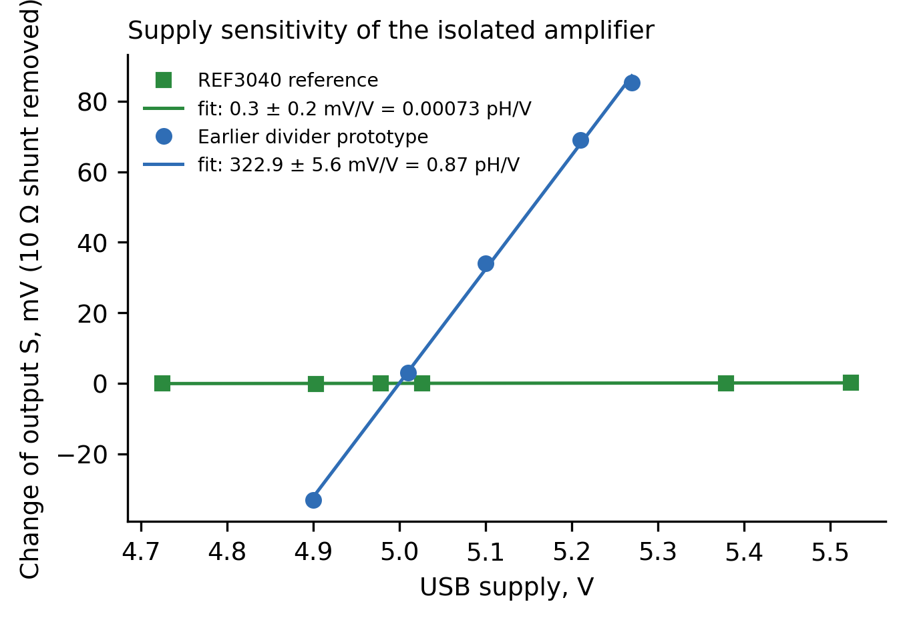{width=60%}

*Figure 9. Supply sensitivity of the isolated amplifier with the REF3040 reference and, for historical
comparison only, the same board before the rework (divider reference): change of the output S from its fitted value
at 5.0 V. S is corrected point by point for the voltage drop across the tester's 10 Ω
current shunt, and for the REF3040 board normalized to the mean E of the sweep.*

### 7.3 Recovery of applied currents

**Principle and correction.** A resistor *R*t = 9.73 MΩ connected from the BNC center to the
shield, that is from the input node to the reference (Figure 4, dashed), and not across *R*, draws a known current *I* = −*E*/(*R* + *R*t) through the series resistor. The input node also
carries its own current (of the board, the tester's node and the connections), which flows
through *R* alone when *R*t is absent. If this current stays the same when *R*t is connected,
it divides between *R* and *R*t, and only the fraction *R*t/(*R* + *R*t) = 0.164 of it flows through
*R*. The contribution of *R*t is therefore calculated as *I*(with) − 0.164·*I*(without). The
assumption is that the node's own current does not change with the node voltage, which falls to
about 0.164·*E* with *R*t connected, or with the node resistance.

**Known currents, 18 pA to 1.7 nA.** The check was made on 8 November 2026 on the isolated amplifier
with the final firmware (*R* = 49.61 MΩ, *R*t = 9.73 MΩ, 22.6 °C;
`data/A2_known_currents_2026-11-08_run7.csv` and `_run9.csv`). At each *E* the reading was recorded for
2 min without *R*t, 2 min with it and 2 min without it again, dropping the first 30 s of each
phase. With the correction, the nine points at ±1 and ±3 mV differ from the expected current by at
most 0.5 pA (RMS 0.23 pA; Table 2); at 10, 30 and 100 mV the differences are 0.05, 0.14 and 0.19 % of
the current. Subtracting the full baseline instead produced an excess of +2.7 to +3.0 pA at −1
and −3 mV. *R* = 49.61 MΩ is the sum of its five resistors, each measured on the 40 MΩ range of
the same multimeter as *R*t. This is a check of internal consistency with a correlated scale,
not an independent calibration: the common scale error of the multimeter cancels in the expected
current, as for correlated input quantities in the GUM (Section 5.2 of [20]).

*Table 2. Known currents through Rt = 9.73 MΩ, measured as I(with) − 0.164·I(without), R = 49.61 MΩ, final firmware. Run 7 is one session; run 9 was logged in several starts, described in the README of `data/`.*

| Run | *E*, mV | expected, pA | measured, pA | difference, pA |
|---|---|---|---|---|
| 7 | −3.006 | +50.66 | +50.16 | −0.50 |
| 9 | −3.163 | +53.30 | +53.09 | −0.21 |
| 7 | −1.061 | +17.88 | +17.61 | −0.27 |
| 9 | −1.051 | +17.71 | +17.67 | −0.04 |
| 9 | −1.051 | +17.71 | +17.70 | −0.01 |
| 7 | +1.053 | −17.75 | −17.91 | −0.17 |
| 9 | +1.088 | −18.34 | −18.44 | −0.11 |
| 7 | +3.066 | −51.67 | −51.86 | −0.19 |
| 9 | +3.056 | −51.50 | −51.36 | +0.14 |
| 7 | +10.056 | −169.46 | −169.37 | +0.09 |
| 7 | +29.853 | −503.08 | −502.36 | +0.72 |
| 7 | +99.953 | −1684.41 | −1681.19 | +3.22 |

**What this check confirms and does not confirm.** The check verifies the recovery of an applied current
at a lower source resistance of the input node. Seen from the node, *R* leads to the source *E*
and *R*t to the reference, both of low impedance, so the node is driven through *R* and *R*t in
parallel: *R* ∥ *R*t = 49.61 ∥ 9.73 ≈ 8.13 MΩ, if other paths are neglected, about six times lower
than the 49.61 MΩ of a normal measurement. The
sensitivity of the node to stray currents and to dynamic disturbances therefore differs between
the two configurations. A constant additive shift common to the readings with and without *R*t
would not cancel in the corrected quantity (0.836 of it would remain), so within this model the
residuals limit such a shift to about 0.6 pA. The residuals give no limit on effects that differ between the
configurations with and without *R*t, and they do not give the absolute value of a current measured
without *R*t. The test of acquisition timing in Section 7.5 shows such a case: a pause in the
acquisition shifted the indication without *R*t by −7.2 pA, while the corrected quantity
stayed within 0.5 pA of the expected current. Varying *R*t, or applying the current from an
independent source, would test this further; neither was done.

**Scale.** The specified uncertainty of the multimeter, ±(2 % + 5 digits) per reading, gives about
±2.5 % for *R*. This is the contribution of the measurement of *R* to the scale of every current
reported here. For Table 4 this specification limit is converted to a standard uncertainty by
assuming a rectangular distribution (Section 4.3.7 of [20]), 2.5 %/√3 = 1.4 %; it is not a full
uncertainty of the measuring chain. *R* can also be obtained from the
divider formed by *R* and *R*t, *V*in/*E* = *R*t/(*R* + *R*t), that is *R* = *R*t·(*E*/*V*in − 1); the ratio
measured by the tester at 100 mV in the earlier check (protocol A) gives *R* = 49.70 MΩ, within
0.2 % of the sum. This is not an independent check of the scale: it uses the same *R*t,
measured with the same multimeter, and it rests on the same known-current data as Table 3.

**Earlier check, 0.17–1.7 nA.** An earlier check was made with the same board before the rework
(divider reference) and with firmware that truncated *E* (protocol A, `data/A_10M_run3.csv`); the
recovered current depends only on the ratio *V*in/*E*, which the transfer line measures
whatever the gain and zero of the amplifier. The logs were recorded with an earlier, incorrect
value of 47.94 MΩ in the firmware; all currents measured through *R* in this paper are rescaled by
47.94/49.61 = 0.966. At each of three voltages the reading was recorded for 1 min without
*R*t, 2 min with it and 1 min without it again; the median without *R*t was subtracted from
the median with *R*t; this full difference was used without the correction above, and the
effect of that omission was not re-evaluated. The
measured differences deviated from the calculated currents by +0.06, +0.16 and −0.22 % at
100, 30 and 10 mV (Table 3, Figure 10). In the 30 mV series the phase after *R*t was removed was recorded at *E* = 10.2 mV;
using only the baseline at 30 mV changes that deviation from +0.2 % to +0.4 %. The truncation
of *E* (up to 1.3 pA at *R* = 49.61 MΩ) cancels where *E* was equal in both phases; otherwise it is
at most 0.07, 0.25 and 0.75 % of the currents at 100, 30 and 10 mV. These are upper bounds of a
possible error, not deviations found. This check is kept as supporting material; Table 2 is the
main result.

*Table 3. Earlier check: known currents through Rt = 9.73 MΩ with R = 49.61 MΩ, board with divider reference, firmware with truncated E. Relative difference = (measured − expected) / expected.*

| *E* | expected | measured | relative difference |
|---|---|---|---|
| 100.0 mV | −1685.2 pA | −1686.3 pA | +0.06 % |
| 30.0 mV | −505.6 pA | −506.4 pA | +0.16 % |
| 10.0 mV | −168.5 pA | −168.1 pA | −0.22 % |

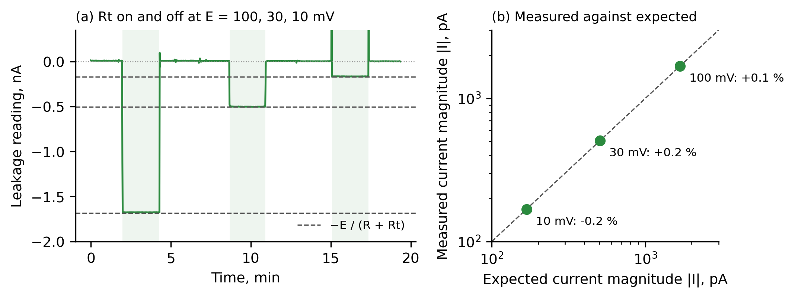

*Figure 10. Known currents, earlier check (Table 3). (a) Current reading while a 9.73 MΩ resistor is connected
(shaded) and removed at E = 100, 30 and 10 mV; dashed: −E/(R + Rt). (b) Measured against
expected current.*

### 7.4 Repeatability and drift

**Noise floor.** With the isolated amplifier connected, *E* ≈ +100 mV and no external test
resistor, the current was logged for one hour with the series resistor shorted and for one
hour with it in circuit, at 24 °C; relative humidity was not recorded
(`data/B3_noise_shorted_2026-10-28.csv`,
`data/B2_noise_open_2026-10-28.csv`, Figure 11). The Allan deviation of the indicated current was
0.19 pA (shorted) and 0.43 pA (in circuit) at 1 s, and 0.06 and 0.10 pA at 1 min; above
about 5 min both were 0.08–0.10 pA. The high-impedance node therefore doubles the
short-term noise, while at long averaging times both are limited by drift of the measuring
chain. The short-term values follow from the ADC. With the resistor shorted, the scatter of
the 25 samples of *S* within a reading was 0.5 mV (two counts), and averaging and the filter
left 0.055 mV between successive readings, or 9 µV at the input; with 2.2 µV from the *E*
channel this gives 0.19 pA, the measured value. The thermal current noise of *R*, 18 fA/√Hz,
gives about 0.04 pA RMS in the equivalent noise bandwidth of one reading of about 116 ms
(4.3 Hz) before the filter; in quadrature this is less than 1 % of the 0.43 pA measured in
circuit. With the resistor in circuit the scatter within a reading rose to 6 mV in *S*
(about 1 mV at the input), consistent with pickup at the high-impedance node; its source was
not localized. Averaging over the roughly
0.1 s of a reading removed most of it and left 0.13 mV between readings, which is the 0.43 pA above. Up to about 5 s this deviation falls more slowly than 1/√*τ*
(Figure 11b), so part of the pickup varies more slowly than one reading. With the resistor shorted the input current causes no drop across *R*, so the
indicated current should be zero, yet it rose
from +0.05 to +0.49 pA over the hour: the zero of the transfer line drifts by up to about
0.5 pA per hour, of which the toggle method removes the linear component. These values describe statistical
resolution, not calibrated accuracy below the lowest verified source, 18 pA.

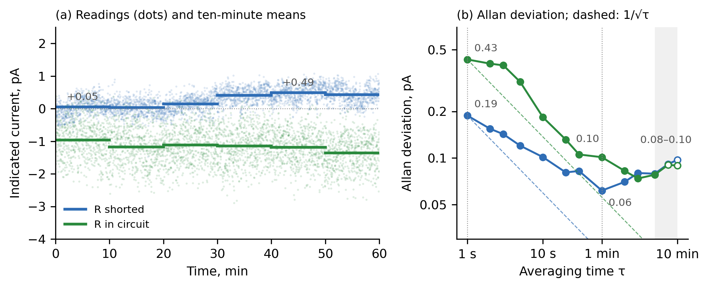

*Figure 11. Noise floor of the isolated amplifier at E ≈ +100 mV, one hour each with the
series resistor shorted and in circuit (`data/B3_noise_shorted_2026-10-28.csv`,
`data/B2_noise_open_2026-10-28.csv`). (a) Single readings (dots) and ten-minute means
(segments); labeled: the first and largest ten-minute means with the resistor shorted, in pA.
(b) Allan deviation of the indicated current; labeled: the values at 1 s and 1 min (dotted)
and the range above 5 min (shaded), in pA; dashed: decrease as 1/√τ from the 1 s value,
expected for uncorrelated noise; open circles: fewer than ten blocks in the hour. All values
are recomputed by `analysis/paper_numbers.py`.*

**Toggle current of the isolated amplifier.** Toggle runs gave −3.18 ± 0.12 pA at *E* = −99 mV
(eight cycles of 60 s, mean ± SEM; `data/T_toggle_REF3040_2026-10-28.csv`, Figure 12) and
−1.14 ± 0.07 pA at *E* = +100 mV (eight cycles of 30 s;
`data/T_toggle_+100_REF3040_2026-10-28.csv`); in the same phases the transfer line gave
−3.27 and −1.12 pA. When the button was held by hand, the reading of *E* differed by
8–31 µV between the two states. A real change in *E* cancels in *V*in − *E*. An error remains if
handling changes the measured *E* without changing the actual voltage, for example through
pickup at the ADC input. The observed change corresponds to 0.16–0.6 pA and is used as an
upper bound for this specific error mechanism. In the two one-hour runs the button was taped; between the shorted and
the open run (5 min apart) the tape was removed, *E* differed by 4 µV and the current was
−1.3 pA. The toggle current at +100 mV is therefore about −1.1 to −1.3 pA (hand-held toggle
−1.14 ± 0.07 pA; single taped transition −1.3 pA). The toggle current indicated on the board,
which includes any current of the tester's own input node, was −3.2 pA at −99 mV and about
−1.1 to −1.3 pA at +100 mV. Intermediate voltages were not measured. Table 4 lists the
contributions to the uncertainty of the toggle results.

*Table 4. Uncertainty of the toggle results, pA. The first block is the random part, the second the scale, the third the state-dependent systematic; they are not summed.*

| Contribution | *E* = −99 mV | *E* = +100 mV |
|---|---|---|
| Result, mean of eight cycles | −3.18 | −1.14 |
| Random: standard error of the mean | 0.12 | 0.07 |
| Random: 95 % interval, Student t (7 d.f.) | −3.46 … −2.91 | −1.30 … −0.99 |
| Random: 95 % interval, moving-block bootstrap (blocks of 2 cycles) | −3.43 … −2.97 | −1.30 … −1.06 |
| Scale: standard uncertainty from the measurement of *R* (±2.5 % limit, rectangular, 1.4 %) | 0.05 | 0.02 |
| Random and scale in quadrature, standard uncertainty (excludes the state-dependent bound) | 0.13 | 0.07 |
| State-dependent systematic, this mechanism only: bound from the change of the *E* reading between states (8 and 31 µV) | ≤0.16 | ≤0.62 |
| Gain of the transfer line, slow drift of its zero (linear component removed by toggling) | <0.01 | <0.01 |
| Timing of the ADC acquisition (7–9 pA between timing settings; Section 7.5) | not bounded | not bounded |

Adjacent cycles share a shorted phase, so they are not independent: the lag-1 autocorrelation
of the cycle currents is +0.43 at −99 mV and +0.12 at +100 mV. The block bootstrap, which keeps
neighboring cycles together, gives standard errors of 0.12 and 0.06 pA, the same as the simple
ones (`analysis/paper_numbers.py`, section T). With eight cycles and one block length, this
describes the variability of these series; it does not show that the correlation is negligible
in general. The 0.13 and 0.07 pA are the combined standard uncertainty of the random and scale
parts only, not a full combined uncertainty of the toggle current.
The state-dependent bound is reported separately. It is ≤0.16 pA at −99 mV and ≤0.62 pA at
+100 mV. Thus, the +100 mV result is −1.14 pA, with a random-and-scale standard uncertainty of 0.07 pA and a
possible state-dependent shift of up to 0.62 pA. These figures do not include the effect of the
timing of the ADC acquisition (Section 7.5), which is larger than every other entry of Table 4.

The nonlinearity of the transfer line, stated in Section 7.2 only as better than about 0.1 mV
(2 pA at *R* = 49.61 MΩ), does not limit the toggle current at this level. At fixed *E* the
input differs between the two states only by *I*·*R*, about 0.2 mV or less for the currents of
Table 4, so a static nonlinearity enters both states almost equally and cancels in their
difference; it would enter fully only in an absolute reading compared with the line.

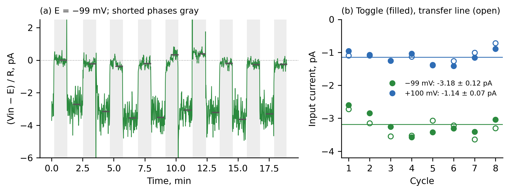

*Figure 12. Toggle runs on the isolated amplifier. (a) (Vin − E)/R during the run at
E = −99 mV; gray: resistor shorted by the button; bars: phase means used; spikes while the
button is handled are clipped. (b) Current of each cycle from the toggle method (filled)
and from the transfer line (open) at E = −99 mV (green) and +100 mV (blue); lines: means of
the toggle method.*

**Repeatability between days.** The toggle runs were
repeated on 9 November 2026 on the same amplifier with the final firmware, at least 15 min after the
polarity switch was last changed: −4.58 ± 0.12 pA at *E* = −100 mV (eight cycles of 60 s,
`data/T_toggle_-100_2026-11-09.csv`) and +0.47 ± 0.09 pA at *E* = +100 mV (eight cycles of 30 s,
`data/T_toggle_+100_2026-11-09_b.csv`). These differ from the values of Table 4 by 1.4 and 1.6 pA,
far more than the repeatability within one run. The mean of the two polarities was −2.06 pA, against
−2.16 pA in the earlier runs, while their half-difference rose from 1.0 to 2.5 pA. Room temperature
was not recorded in these runs. The sub-picoampere repeatability within a run is therefore not
the repeatability between sessions.

Part of the difference at −100 mV may come from the history of the polarity switch (Section 7.5).
The wait of 15 min after a flip was adopted only after the runs of 28 October. The −99 mV run of
that day followed the capture of the −98.9 mV point of the transfer line, which was taken after
the +100 mV point, and the time since the switch had been moved was not logged. Its first three
cycles (−2.60, −2.85 and −3.25 pA) were less negative than the remaining five (−3.04 to
−3.58 pA, mean −3.35 pA), as expected during the transient. Without the first three cycles the
difference from 9 November is 1.2 pA instead of 1.4 pA, so the transient accounts for only a
small part of it.

### 7.5 Systematic effects and limits of interpretation

**Polarity history.** Flipping the polarity switch affects the indication. In runs of 15 min per switch position
(`data/P_polarity_center_900s_2026-11-09.csv` at ±1.12 mV,
`data/P_polarity_center_100mV_2026-11-09.csv` at ±100 mV) the indication after each flip moved by
2–3 pA and decayed over about 10 min, with the sign set by the direction of the flip. The transient
did not scale with *E*: in the first 3 min after moving the switch from center to plus it was +2.98 pA
at +1.12 mV and +3.00 pA at +100 mV. When *E* was changed from +1.1 to +100 mV with the trimmer alone,
without moving the switch, no transient appeared, and ten-minute medians stayed between −0.44 and
+0.20 pA for 77 min (one such case). With the resistor shorted by the button, the same sequence stayed
within ±0.5 pA and no difference between polarities remained
(`data/P_polarity_shorted_100mV_2026-11-09_b.csv`), so the effect is present only with the resistor in
circuit and its origin was not identified. A toggle run started about 3 min after a flip gave cycle
currents falling from +3.39 to +0.83 pA over 20 min (`data/T_toggle_+100_2026-11-09.csv`): the toggle
method does not remove this transient. The wait of at least 15 min after a flip (Section 6) is an
empirical rule for this prototype, based on these few runs; a settling criterion was not
established.

**Acquisition timing.** The indication also depends on the timing of the ADC acquisition. A temporary firmware, not part of
the published design, changed only the order and timing of the ADC readings
(`data/W_diag_100mV_2026-11-09.csv`). With the resistor in circuit and relative to the normal order
(*E*, then *S* immediately after it), a pause of 300 ms between the two readings shifted the indication
by −8.0 pA at +100 mV and −6.9 pA at −100 mV, and reading *S* before *E* shifted it by −9.1 and
−8.6 pA. Omitting the readings of *E* and of the supply current changed it by less than 0.25 pA. The
normal order was reproducible within 0.2 pA before and after the other settings. The difference between
the polarities remained in every setting (3.7–5.2 pA). The mechanism was not identified, and the
data do not establish which acquisition setting gives the true current. Readings below about
10 pA must therefore be treated as indications. The limit of 10 pA is a convention set just
above the observed shift of 7–9 pA, not a derived detection limit. The observed shift could also produce an error of
about 5 % in a single absolute reading at 0.17 nA. No ADC input is connected to the
high-impedance node, so the shift does not come from an ADC input on that node; coupling through
the amplifier, its supply or ground, or the cable remains possible, and the ADS1115 samples its
inputs through a multiplexer and switched-capacitor stage [13], whose interaction with the
circuit can depend on the order and timing of conversions. These are directions for further
tests, not established explanations.

A further run with the same temporary firmware tested whether this shift is a constant offset of the
indication (`data/W_gap_Rt_2026-11-10.csv`; one run at *E* = +3 mV and one polarity). The 300 ms pause
changed the indication by −7.2 pA without *R*t and by −0.46 pA with it connected, so the shift is
not a constant offset. The quantity *I*(with) − 0.164·*I*(without) differed from the expected current of
−50.7 pA by −0.27 and −0.23 pA in the normal order, before and after the setting with the pause, and by
+0.46 pA with the pause; the full difference with the pause would have been in error by +6.2 pA. The known
currents of Table 2 were therefore reproduced within 0.5 pA in both settings, while the indication
without *R*t shifted by 7 pA. This does not identify the mechanism and does not show which
reading without *R*t is true.

**Dependence on voltage.** The indication differed by about +10 pA/V between the two voltages in the runs of Table 4 (±0.7 pA/V
statistically, at most ±4 pA/V with the bounds of Table 4). This is a difference between two
separate runs of opposite polarity and must not be read as a slope: it was 25 pA/V in the runs of
9 November, and the half-difference between the polarities was about 3 pA at
±1.12 mV and about 2 pA at ±100 mV, so it is not proportional to *E*. A leakage resistance from the
input to a fixed potential would make the current change in the opposite direction,
−1/*R*leak per volt, as *R*t does in Table 2, so the difference is not explained by a
simple resistive path to a fixed potential; its cause was not identified.

**Origin of the indicated current.** The LMC6042 is specified at a typical input current
of 2 fA but a maximum of 4 pA [17]; the indicated current lies within this limit, so the
datasheet alone does not decide whether it comes from the operational amplifier, the board
or the tester's node. No run without the amplifier (the tester's own node alone) was made, and
the method does not separate the contribution of the tester from that of the board.

**Meaning for pH.** An indicated current of up to 4.6 pA (the largest magnitude on two days) through an
electrode of 100 MΩ to 1 GΩ gives up to 0.5–4.6 mV, or 0.008–0.08 pH, as an order of magnitude.
A constant product *I*·*R*el, that is, a constant current through an electrode of constant
resistance, only shifts the zero, which a two-buffer calibration absorbs. What remains an error
of a titration is a change of this product between calibration and measurement, for example
with temperature or humidity; input currents of FET-input amplifiers double for every 10 °C [7],
and the electrode resistance also rises at low temperature [2], so a logged current is more
informative than a single value.

### 7.6 Diagnostic examples

**Failed amplifier.** That board showed an input shift of 90–205 mV with a 10–20 MΩ
source, an error of 1.5–3.5 pH. Replacing the LMC6042 with another LMC6042 and with a TL062
(JFET input) did not remove the observed current; this does not exclude an abnormal operating
condition common to both amplifiers or an effect of the surrounding circuit. The tester then measured
the current at seven voltages from −300 to +300 mV with *R* = 20 MΩ (protocol H; the 50 MΩ chain was not yet built, so a 20 MΩ resistor was used; values
transcribed from the logger display, raw log not preserved, board no longer available, so this is a preliminary observation only): 12.01 nA on average,
standard deviation 0.06 nA, slope −0.08 ± 0.11 nA/V. A saturated or strongly nonlinear
output would have produced a slope near −1/*R* = −50 nA/V. A simple resistive path from the
input to a constant potential would have to exceed 2.5 GΩ (3σ), and driving 12 nA through it
would need more than 30 V, far beyond the ±5 V on the board. The leakage
was therefore inconsistent with such a path and consistent with an approximately
voltage-independent current over the tested range. Its physical origin was
not identified, and the board was replaced by the redesign.

**Commercial module.** As an example of a widely used low-cost board, a diymore PH-4502C
module was tested (protocol G, `data/G_ph4502c.csv`). Its input stage is a TLC4502C [21]
(CMOS input); the module is not isolated. After a two-point
calibration at ±100 mV (+2.863 V/V, zero 2.470 V), each voltage from −431 to +425 mV was
applied in an upward sweep with the series resistor in circuit and then in a downward
sweep with it shorted. With *R* shorted, input current produces no voltage drop across it.
Nevertheless, the PH-4502C departed from the two-point calibration line by 5 mV at ±250 mV and
11 mV at ±430 mV, equivalent to 0.09 and 0.19 pH. The isolated amplifier remained within
0.14 mV of its two-point line through ±100 mV over its linear range of approximately −200 to
+220 mV. Its output reached the rail at +250 mV, so direct comparison is limited to the shared
linear range (Figure 13a). The smaller residual of 0.066 mV reported in Section 7.2 comes from
a fit to all points. The errors at ±250 and ±430 mV agreed between the two sweeps within
0.2 mV, which supports a reproducible nonlinear component rather than drift between the
sweeps; interleaved measurements at each voltage were not made.

The two sweeps were made in opposite directions, so the difference between the
two states cannot be separated from time, drift, hysteresis and the order of points, and the
corresponding currents are preliminary. They were between −2 and +13 pA at seven voltages,
with standard errors of 2–7 pA (Figure 13b). The point at *E* = 0 was excluded as an anomaly
of unidentified cause: there the two sweeps disagree by 3.4 mV (equivalent to 68 pA), more than
five times the largest difference at any other voltage (0.6 mV), and *E* = 0 was the only point
set with the polarity switch in its center position, which disconnects the cell, so the state
of the source differed. A separate protocol for the zero would be needed to decide its cause.
With the resistor in circuit, the module's reading scattered by 30–40 pA; with the resistor
shorted the scatter fell below 1 pA except at −249 and −431 mV (8 and 24 pA), which is
consistent with interference pickup at the high-impedance node; whether it enters at the module
input or through the tester's own node was not separated. The tester thus revealed the
nonlinearity of the module's transfer function and showed pickup, which a single reading
combines; a quantitative separation of the module's input current from its nonlinearity would
need interleaved states at each fixed *E*.

**Isolation.** A qualitative ground-coupling demonstration, not a quantitative measurement of isolation (one run per module, phases marked by hand, no repeats): an inert wire was placed in a pH 6.86 buffer and an AA
cell was connected through 100 kΩ between that wire and supply ground (protocol I). Reversing the cell
caused no change of the isolated amplifier reading within its logged resolution of 0.1 mV
(all readings between −0.1 and +0.2 mV) over the 9.4 min sequence
(`data/I_isolation_board.csv`, Figure 13c). Under the same test a non-isolated
PH-4502C module moved from a baseline near +1 mV to steady values of about −53 and +160 mV
for the two polarities (with a peak of +194 mV on connection), and returned to baseline
when the cell was removed (`data/I_isolation_PH4502C_merged.csv`).

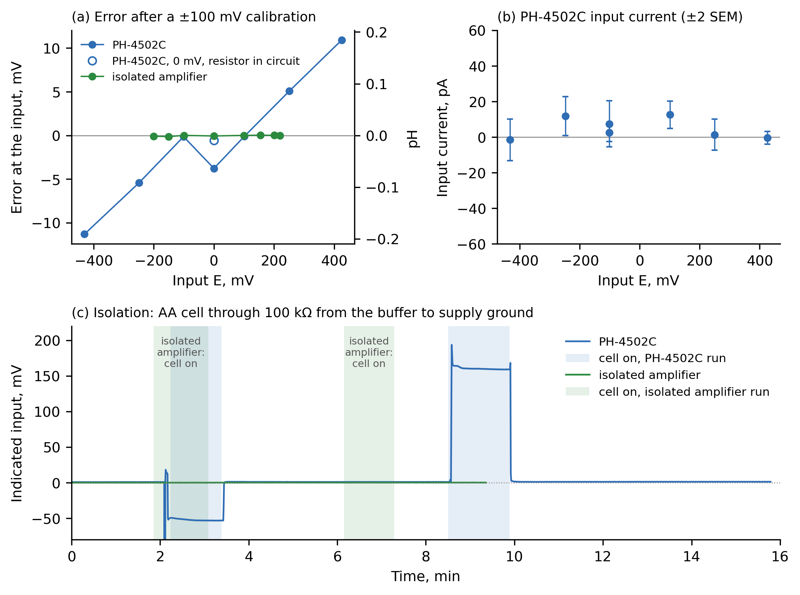

*Figure 13. A PH-4502C module and the isolated amplifier. (a) Error referred to the
input after a two-point calibration at ±100 mV, resistor shorted. (b) Preliminary input current of the
module: reading with the resistor in circuit minus the reading shorted, from sweeps in opposite directions; bars ±2 standard
errors; E = 0 is excluded. At E = 0 the two sweeps disagree by 3.4 mV (−0.4 and −3.8 mV);
both points are shown in (a), and the cause was not identified. (c) Qualitative isolation (ground-coupling) test:
indicated input while an AA cell is connected through 100 kΩ between the
buffer and supply ground, in two separate runs, time from the start of each log; shaded
blue (PH-4502C) and green (isolated amplifier): phases marked by hand in the logs as cell
connected, one polarity and then the other. A transient of −0.8 V on connecting the cell
to the PH-4502C is off the scale.*

### 7.7 Application demonstration: the pH amplifier of an alkalinity titrator

The tester grew out of one application: the pH amplifier of an alkalinity (KH) titrator for
a reef aquarium. The titrator had priority, and the tester was built when the titrator was
already running with the redesigned amplifier of Section 7.1; it was then used to measure
what had gone wrong with the first amplifier and to check the new one.

The first amplifier looked functional, but its output did not change when a working
electrode was connected. On it the tester indicated an input current of about 12 nA, nearly
independent of the voltage, which replacing the operational amplifier did not remove
(Section 7.6, preliminary). On the redesigned amplifier it indicated currents below 10 pA, between −4.6 and
+0.5 pA on two days (Section 7.4). Taken at face value, 4.6 pA through an electrode of 1 GΩ
would shift the zero by about 0.08 pH, a constant offset that a two-buffer calibration absorbs.

The second board of Section 7.1, with the REF3040 reference, ran in the titrator from 10 to
19 October 2026 and gave
208 hourly KH results (protocol K, `data/K_station_kh_history.csv`, Figure 14; 1 dKH =
0.357 mmol/L of total alkalinity). They follow the daily cycle of the aquarium: KH fell
during the day to a minimum between 18:00 and 23:00 and recovered at night, with a daily
range of 0.25–0.54 dKH (0.09–0.19 mmol/L). Between 01:00 and 09:00, when KH was steady, the
72 results averaged 8.02 dKH (2.86 mmol/L) with a standard deviation of 0.031 dKH
(0.011 mmol/L, 0.4 %). This is the observed spread; it includes any real change of KH in the
aquarium and equals the repeatability of the titrator only if such changes were negligible in
this window. Three single results (1.4 %)
lay 0.30–0.39 dKH below the mean of the results just before and after them; their cause was not identified. No
reference titration was made, so these results show the working of the whole titrator, not its
accuracy, and not the amplifier or the tester alone; they are not a metrological
characteristic of the tester and are not comparable with the figures of Sections 7.3–7.5.

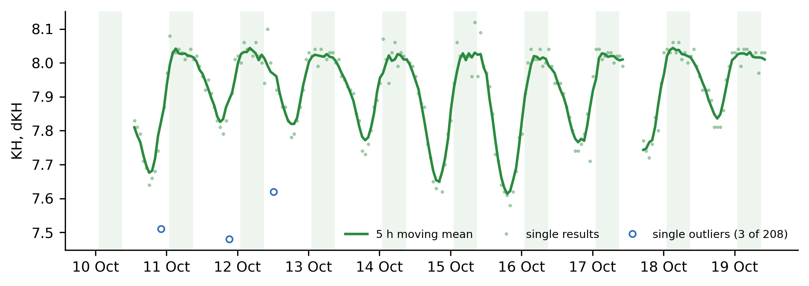

*Figure 14. Hourly KH of a reef aquarium measured by the titrator with the redesigned
amplifier, 10–19 October 2026 (`data/K_station_kh_history.csv`). Dots: single results;
line: 5 h moving mean; open circles: single outliers (3 of 208); shaded: 01:00–09:00, the
window of the night spread.*

In a separate run, the isolated amplifier of Section 7.1 was connected to a
DANOPLUS electrode; the tester supplied the amplifier and recovered *V*in from
*S* through the transfer line, but the input current was not evaluated in this run. The
electrode was recorded for 62.9 min in buffers of pH 4.00, 6.87 and 9.20 at 23 °C
(interpolated from the manufacturer's table; nominally 4.00, 6.86 and 9.18 at 25 °C;
protocol F, `data/F_buffers.csv`). The final 5 min in each buffer gave +159.01 ± 0.28,
−0.991 ± 0.029 and −130.055 ± 0.058 mV (mean ± SD). A line through these values had a slope
of −55.60 mV/pH (94.6 % of the ideal 58.76 mV/pH at 23 °C), crossed zero at pH 6.857 and
had a largest residual of 0.31 mV. The slope is approximate, because the electrode was
still drifting in the pH 4 buffer (SD 0.28 mV, against 0.03–0.06 mV in the other two), and
it characterizes the electrode–buffer system, not the amplifier alone.

### 7.8 Capabilities and limitations

**Capabilities**

- Indicates the current through the series resistor of an amplifier in circuit from the
  amplifier's own output; no separate measuring instrument is connected to its input node.
- Currents applied through a known resistor recovered with the final firmware, after the
  correction for the division of the node's own current, within 0.5 pA at 18–53 pA and within
  0.19 % at 0.17–1.7 nA (Table 2); an earlier check gave 0.06–0.22 % (Table 3). These are
  consistency checks: *R* and *R*t were measured with the same multimeter.
- Statistical resolution of 0.06–0.1 pA at 1 min within one run (Allan deviation); this is
  repeatability, not accuracy.
- Reveals nonlinearity of the transfer function with the series resistor shorted and shows
  pickup.
- Simulator voltage from an LR44 cell: up to ±430 mV used, within 0.2 mV of a multimeter
  over ±200 mV.
- Series resistance of 49.61 MΩ (five 10 MΩ resistors); the amplifier is supplied with 5 V
  from the tester, and its supply current is measured on a 10 Ω shunt.
- Measurement cycle of about 0.4 s; readings on a web page and the OLED display, with
  continuous CSV logging.
- Diagnosed the failed amplifier of an alkalinity titrator (about 12 nA, preliminary) and
  indicated below 10 pA on the redesign (Sections 7.6 and 7.4).
- Component cost of the prototype about EUR 15 (Section 4).

**Limitations**

- The absolute input current of a board is not established: the indicated current also
  contains any current of the tester's own node and connections, which the method does not
  separate, and effects that depend on the acquisition (Section 7.5).
- The recovery of applied currents was checked at a node resistance of about 8.13 MΩ, with
  *R*t connected; it does not confirm the indication without *R*t (Section 7.3).
- No known current below 18 pA was applied. The −4.6 to +0.5 pA indicated on the isolated
  amplifier on two days is an indication; the two days differed by 1.4–1.6 pA at the same
  voltage.
- With the series resistor in circuit the indication shifted by 7–9 pA when only the timing of the
  ADC acquisition was changed. The mechanism was not identified, and below about 10 pA the reading
  is an indication, not a measurement of the input current.
- After the polarity switch is flipped, the indication changes by 2–3 pA and settles over about
  10 min, independently of the magnitude of *E*; toggle runs do not remove this transient. Its
  origin was not identified. Wait at least 15 min after a flip.
- The difference between the indications at opposite polarities is not proportional to *E* and
  changes between days; it does not define a slope of the input current against voltage.
- The measurement of *R* contributes about ±2.5 % (multimeter specification) to the scale of
  every current; no independent calibration of the scale was made.
- At longer averaging times the resolution is limited by drift of the measuring chain: the
  zero of the transfer line drifts by up to about 0.5 pA per hour. Toggle runs remove only
  its linear component, not nonlinear drift, steps of the zero or disturbances that depend
  on the state of the button.
- Of the logs recorded with firmware that truncated *E* (Section 7.1), three results depend on
  it and were not repeated with the final firmware: the PH-4502C currents (−2 to +13 pA, preliminary), the earlier known currents of
  Table 3 (by at most 0.75 %) and the linearity, which is stated only to about 0.1 mV.
- A change of the USB supply between calibration and measurement appears as an apparent
  current on amplifiers whose zero follows the supply. From the sweeps of Section 7.2 this is
  about 1 pA per millivolt of supply for the board with the divider reference (323 mV/V at the
  output) and below 1 pA per volt, not distinguishable from zero, for the REF3040 board.
- The ADC inputs bridge the isolation of an isolated amplifier through their input impedance
  during the test.
- The 12 nA leak on the failed amplifier is a preliminary observation only (Section 7.6); its
  origin was not identified.
- The tester suits voltage-input amplifiers that run from a single 5 V supply and whose input
  reference lies within 0–3.3 V of its ground; it does not suit transimpedance amplifiers
  (Section 2). It was demonstrated on pH amplifiers only.
- The pH display uses either the ideal Nernst slope or a three-buffer calibration with buffer
  values corrected for a temperature entered by the user. There is no temperature sensor;
  the tester is a test instrument, not a pH meter.

## Ethics statements

This work did not involve human subjects or animal experiments.

## CRediT author statement

Ihor Tkachenko: Conceptualization, Methodology, Software, Resources, Investigation,
Validation, Formal analysis, Data curation, Visualization, Writing – original draft, Writing – review and editing.

## Declaration of competing interest

The author declares no known competing financial interests or personal
relationships that could have appeared to influence the work reported in this paper.

## Declaration of generative AI and AI-assisted technologies in the manuscript preparation process

During the preparation of this work the author used Claude (Anthropic) and OpenAI Codex for
text editing and for writing data-analysis, plotting and data-logging software. After using
these tools, the author reviewed and edited the content as needed and takes full
responsibility for the content of the published article. All measurements were performed by
the author on the author's own hardware.

## Acknowledgments

The author thanks Franck ("Bubule") for sharing the original pH interface circuit with
the cap-recifal.com community.

The author also thanks the household cats, Susie, Tigra and Michelle, for their steady
moral support during the long measurement sessions.

This research did not receive any specific grant from funding agencies in the public,
commercial, or not-for-profit sectors.

## References

1. A.J. Bard, L.R. Faulkner, Electrochemical Methods: Fundamentals and Applications, 2nd ed.,
   Wiley, 2001.
2. H. Galster, pH Measurement: Fundamentals, Methods, Applications, Instrumentation, VCH, 1991.
3. R.P. Buck, et al., Measurement of pH. Definition, standards, and procedures (IUPAC
   Recommendations 2002), Pure Appl. Chem. 74 (2002) 2169–2200.
   https://doi.org/10.1351/pac200274112169
4. A.G. Dickson, C.L. Sabine, J.R. Christian (Eds.), Guide to Best Practices for Ocean CO2
   Measurements, PICES Special Publication 3, 2007, SOP 3b: Determination of total
   alkalinity in sea water using an open-cell titration.
5. Keithley Instruments, Low Level Measurements Handbook, 7th ed., 2014.
   https://download.tek.com/document/LowLevelHandbook_7Ed.pdf (accessed 1 November 2026).
6. Hanna Instruments, Simulateurs de précision pour instruments de pH et mV, HI8427 • HI931001,
   product specification sheet.
   https://www.hannainstruments.be/mediastorage/hanna-be/FSDocument/A50000/53558/descriptif-produit-hi8427-hi931001-fr.pdf
   (accessed 27 October 2026).
7. Analog Devices, MT-038 Tutorial: Op Amp Input Bias Current, Rev. 0, 2008.
   https://www.analog.com/media/en/training-seminars/tutorials/MT-038.pdf (accessed 1 November 2026).
8. J. Bryant, Simple op amp measurements, Analog Dialogue 45 (April 2011).
   https://www.analog.com/en/resources/analog-dialogue/articles/simple-op-amp-measurements.html (accessed 1 November 2026).
9. T. Del Castillo-Santaella, J. Maldonado-Valderrama, M.A. Fernandez-Rodriguez, Autotitrator
   based on an Arduino Open Source Pump, HardwareX 15 (2023) e00464.
   https://doi.org/10.1016/j.ohx.2023.e00464
10. K.M. McLean, A.L. Pasulka, E.E. Bockmon, A low-cost, accessible, and high-performing
    Arduino-based seawater pH control system for biological applications, HardwareX 10
    (2021) e00247. https://doi.org/10.1016/j.ohx.2021.e00247
11. K.L. Onthank, et al., The Open acidification Tank Controller: an open-source device for
    the control of pH and temperature in ocean acidification experiments, HardwareX 14
    (2023) e00435. https://doi.org/10.1016/j.ohx.2023.e00435
12. Atlas Scientific, EZO-pH Circuit, datasheet and product page.
    https://atlas-scientific.com/ezo-ph-circuit (accessed 1 November 2026).
13. Texas Instruments, ADS111x Ultra-Small, Low-Power, I²C-Compatible, 860-SPS, 16-Bit ADCs,
    datasheet. https://www.ti.com/lit/ds/symlink/ads1115.pdf (accessed 1 November 2026).
14. Open Source Hardware Association, Open Source Hardware (OSHW) Definition 1.0.
    https://www.oshwa.org/definition/ (accessed 1 November 2026).
15. [dataset] I. Tkachenko, pH electrode simulator and leakage tester: design files, firmware,
    analysis scripts and raw data (ph-leakage-tester), Zenodo, version 1.0, 2026.
    https://doi.org/10.5281/zenodo.24111496 (source repository: https://github.com/igorlab/ph-leakage-tester).
16. Franck ("Bubule"), Interface pH pour Arduino isolé, schematic, 2011, in: pH mètre DIY,
    forum thread, cap-recifal.com, 2011–2015.
    https://www.cap-recifal.com/forums/topic/668-ph-m%C3%A8tre-diy/,
    https://www.cap-recifal.com/sites/default/files/files/511/bubule_20111119195948.pdf
    (archived 23 October 2026: https://web.archive.org/web/20261023091542/https://www.cap-recifal.com/sites/default/files/files/511/bubule_20111119195948.pdf,
    https://web.archive.org/web/20261023091649/https://www.cap-recifal.com/forums/topic/668-ph-m%C3%A8tre-diy/)
17. Texas Instruments, LMC6042 CMOS Dual Micropower Operational Amplifier, datasheet.
    https://www.ti.com/lit/ds/symlink/lmc6042.pdf (accessed 1 November 2026).
18. Broadcom, HCNR200 and HCNR201 High-Linearity Analog Optocouplers, datasheet AV02-0886EN.
    https://docs.broadcom.com/doc/HCNR200-HCNR201-High-Linearity-Analog-Optocouplers-DS (accessed 1 November 2026).
19. Texas Instruments, REF30E and REF30 Low Current Voltage Reference in SOT-23-3, datasheet
    SBVS032K. https://www.ti.com/lit/ds/symlink/ref30.pdf (accessed 1 November 2026).
20. JCGM 100:2008, Evaluation of measurement data — Guide to the expression of uncertainty in
    measurement (GUM 1995 with minor corrections), Joint Committee for Guides in Metrology,
    first edition September 2008, corrected version 2010.
    https://www.bipm.org/documents/20126/2071204/JCGM_100_2008_E.pdf (accessed 10 November 2026).
21. Texas Instruments, TLC4501, TLC4502: Family of Self-Calibrating (Self-Cal) Precision
    CMOS Rail-to-Rail Output Operational Amplifiers, datasheet.
    https://www.ti.com/lit/ds/symlink/tlc4502.pdf (accessed 1 November 2026).
