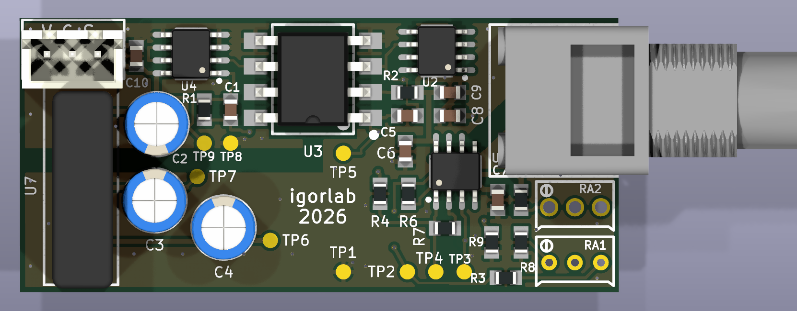
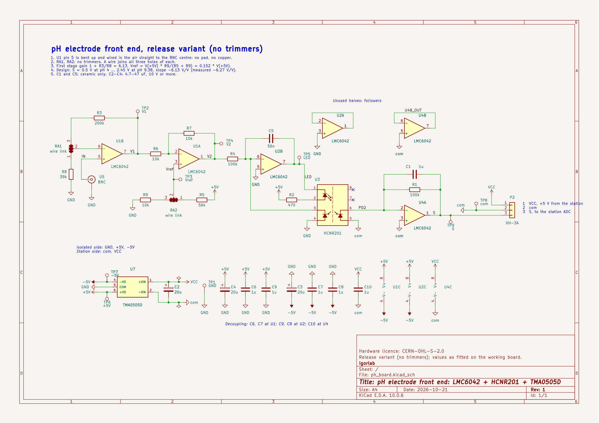

# pH electrode front end: LMC6042 + HCNR201 + TMA0505D

A galvanically isolated electrometer front end for a glass pH electrode, made for an
automated KH titrator on an ESP32. Two measured revisions are retained. Revision A is
the first manufactured board with a divider-derived reference. Revision B replaces the
divider with a REF3040 and is the primary design for publication. Both are without
trimmers.

## Revisions and file status

| Revision | Reference | Evidence | Status of design files |
|---|---|---|---|
| A | R5 = 56 kΩ and R9 = 10 kΩ from the isolated +5 V rail | Protocols A, D, E and the original part of J | Archived BOM `fab/ph_board_bom_rev_a.csv`; the PCB/Gerbers are the common base |
| B | REF3040AIDBZR (U6), 47 kΩ / R9 = 10 kΩ divider | Board-B supply sweep after the 2026-10-24 rework | Primary publication revision; common PCB plus the documented R5/RA2 assembly rework and `fab/ph_board_bom.csv` |

Do not use measurements made on revision A as if they had been repeated on revision B.
The reference is outside the high-impedance input node and does not set the signal gain,
so the earlier gain, leakage and linearity results remain relevant to the unchanged
signal path, but revision B still requires its own post-rework control line, leakage and
linearity check. The measured supply sensitivity changed from 0.87 ± 0.02 pH/V of USB
on revision A to 0.002 ± 0.002 pH/V on revision B.

## Origin

The circuit is a revision of the pH interface that Franck ("Bubule") shared on the French
reef-keeping forum [cap-recifal.com](https://www.cap-recifal.com/forums/topic/668-ph-m%C3%A8tre-diy/) in 2011. With the original component values
the input stage, the second stage and the optocoupler failed when the electrode was
disconnected. The values were changed to stop this and to fit the output to the 0–3 V ADC
input of an ESP32, and the board was laid out anew. Thanks to Franck for sharing it.

The original schematic, *Interface pH pour Arduino isolé* (KiCad, 20 Sep 2011), is
[here](https://www.cap-recifal.com/sites/default/files/files/511/bubule_20111119195948.pdf). The topology is the same; what changed:

| Function | Original (2011) | This board |
|---|---|---|
| Input stage gain | 1 + 255k / (40k + 10k trimmer) | 1 + R3/R8 = 1 + 200k/39k = 6.13, fixed |
| Offset reference | 30k + 10k trimmer + 10k from 5 V (1–2 V) | Revision A: R5 56k / R9 10k from 5 V; revision B: REF3040 followed by 47k / R9 10k |
| Trimmers | two (full scale, pH 7) | none: RA1, RA2 are wire links |
| HCNR201 LED resistor | 255 Ω | R2 470 Ω |
| Servo loop capacitor | 10 pF | C5 56 nF |
| Output stage capacitor | 10 pF | C1 1 µF |
| Supply decoupling | 2.2 µF | 20 µF electrolytic + 1 µF ceramic |
| Isolated converter | DCV010505D | TMA 0505D |
| Input pin | on the board | in the air, straight to the BNC centre |
| Output | 0–5 V for pH 0–14 | 0.5–2.45 V for pH 4–9.4 (ESP32 ADC) |

## Contents

- [`kicad_manufactured/`](kicad_manufactured/): KiCad 10 project.
  - `ph_board.kicad_sch` is the schematic, `ph_board.kicad_pcb` the board.
  - `ph-board.kicad_sym` holds the symbols, `ph_single-easyedapro.pretty` the footprints.
  - `ph_board.kicad_dru` is the isolation rule: copper of the station side keeps 1.8 mm
    from the electrode side.
- [`fab/ph_board_gerbers.zip`](fab/ph_board_gerbers.zip): Gerbers and drill files, exactly the
  package that was ordered on 2026-10-02 (file names `ph_final-*`).
- [`fab/ph_board_bom.csv`](fab/ph_board_bom.csv): parts list.
- [`fab/ph_board_bom_rev_a.csv`](fab/ph_board_bom_rev_a.csv): archived divider-revision
  parts list. The unmodified KiCad schematic shows this base circuit.
- [`docs/ph_board_schematic.pdf`](docs/ph_board_schematic.pdf): the schematic for printing.

## How the files were checked

- The board was laid out first; the schematic was drawn after it, from its connections.
- `kicad_manufactured/ph_board.kicad_pcb` is the file the boards were ordered from (2026-10-02): KiCad
  regenerates the ordered copper, mask, paste and outline Gerbers from it without a
  single difference.
- DRC reports 0 unconnected pads. Schematic parity reports 132 mismatches (footprint
  names, values, net names): the schematic was drawn after the layout and has not been
  re-synchronised with this file. The input has no copper (see below).
- The Gerbers and drill files in `fab/` are the ones that were ordered (2026-10-02), so
  copper, mask and drill are those of the boards that were made. A release rebuilt on
  2026-10-20 differs in the silkscreen (labels moved, «igorlab 2026» added); by the board
  journal nothing else was changed.

## Building it

- **The input has no copper.** Bend U1 pin 5 up so that it touches nothing, and wire it in
  the air straight to the BNC centre. Solder only the shield of the BNC to the board.
- **RA1 and RA2 are not trimmers.** Bend a bare 0.5–0.6 mm wire into a staple, push it
  through holes 1 and 3, and solder it to hole 2 as well. This applies to revision A;
  revision B uses RA2 for its 47 kΩ divider as described below.
- **Two grounds.** GND is the electrode side, com the station side. U3 (HCNR201) and U7
  (TMA0505D) are the isolation barrier. Measure TP2–TP7 against TP1 and TP9 against TP8.
- **Cable to the calibrator.** P2 is 1 VCC, 2 com, 3 S. The calibrator's JST has +5 V in
  the middle, so the cable between them is crossed: wire it by function and check it before
  you power the board.
- **Wash the flux off** around U1 and the BNC: those nodes carry picoamps.

### Revision B: REF3040 assembly rework

Revision B uses the same PCB and Gerbers as revision A. Assemble the common board as
listed in `fab/ph_board_bom.csv`, with these changes:

1. Do not fit R5 (56 kΩ).
2. Place U6, REF3040AIDBZR (SOT-23-3), on the two R5 pads: pin 1 (IN) to the upper
   +5 V pad and pin 2 (OUT) to the lower pad leading to RA2 hole 1. Keep pin 3 (GND)
   clear of the RA2-hole-1 copper and wire it with insulated wire to GND at the lower
   pad of R8.
3. At RA2, fit 47 kΩ between holes 1 and 2 and a wire link between holes 2 and 3.
   R9 remains 10 kΩ and forms the lower arm to GND.
4. Inspect for shorts before power-up. Without power, RA2 hole 1 to TP1 should be about
   57 kΩ and U6 pin 3 to TP1 about 0 Ω.
5. Power the board with a current-limited 5 V supply and verify approximately 4.096 V
   at U6 OUT and approximately 0.72 V nominal at Vref/TP3. The measured prototype gave
   4.09 V and 0.688 V respectively.

The schematic image below shows the common revision-A PCB base. For revision B, replace
R5 with U6 and the 47 kΩ/R9 network exactly as specified above. This documented rework is
the configuration that was physically measured; an untested integrated PCB respin is not
presented as validated hardware.

## Parts

| Ref | Value | Notes |
|---|---|---|
| U1, U2, U4 | LMC6042AIM, SOIC-8 | From an authorised distributor |
| U3 | HCNR201-500E | Analog optocoupler |
| U7 | TMA 0505D | Isolated 5 V to ±5 V, 1 W. Check the pin numbers against your part's datasheet |
| U5 | BNC socket, PCB mount | Centre wired in the air to U1 pin 5 |
| P2 | JST XH, 3 pins | 1 VCC (+5 V), 2 com, 3 S |
| R1, R4 | 100k 0805 1 % | |
| R2 | 470 0805 1 % | HCNR201 LED current |
| R3 | 200k 0805 1 % | First-stage gain 1 + R3/R8 = 6.13 |
| R5 | not fitted in revision B | 56k 0805 1 % only in archived revision A |
| R10 | 47k 0805 1 % | Revision B: RA2 holes 1–2, upper arm from REF3040 OUT to Vref |
| R6, R7, R9 | 10k 0805 1 % | |
| R8 | 39k 0805 1 % | |
| C1, C6–C10 | 1 µF 0805 ceramic | As fitted; 100 nF works too. C1 ceramic only |
| C5 | 56 nF 0805 ceramic | Ceramic only, not 1 µF |
| C2–C4 | 20 µF electrolytic | Any 4.7–47 µF, 10 V or more. C3: + goes to GND |
| RA1 | wire link | See above |
| RA2 | 47k plus wire link | Revision B: 47k on holes 1–2, link on holes 2–3 |
| U6 | REF3040AIDBZR, SOT-23-3 | Revision B; mounted on R5 pads as described above |

Part numbers for the resistors are in [`fab/ph_board_bom.csv`](fab/ph_board_bom.csv).

## Measured results

| | |
|---|---|
| Slope | −6.27 V/V (−6.13 by design) |
| S at 0 mV | 1.692 V |
| Input current, revision A | below 1 pA with the calibrator and a fresh calibration line; the earlier multimeter-bound result was below 8 pA |
| Supply sensitivity, revision A | 0.87 ± 0.02 pH/V of USB |
| Supply sensitivity, revision B | 0.002 ± 0.002 pH/V of USB |

The board was tested with the calibrator from
[github.com/igorlab/ph-simulator](https://github.com/igorlab/ph-simulator).

## Licence

Hardware: CERN-OHL-S v2.
